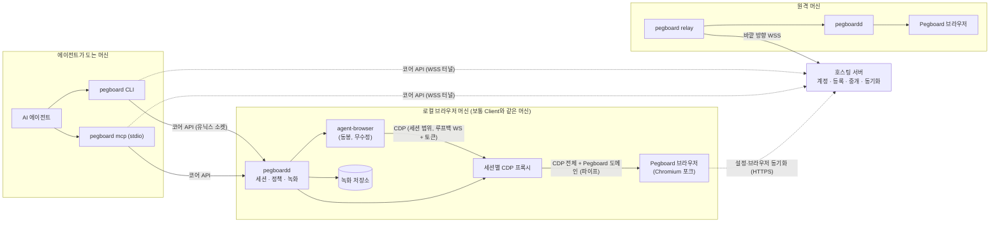
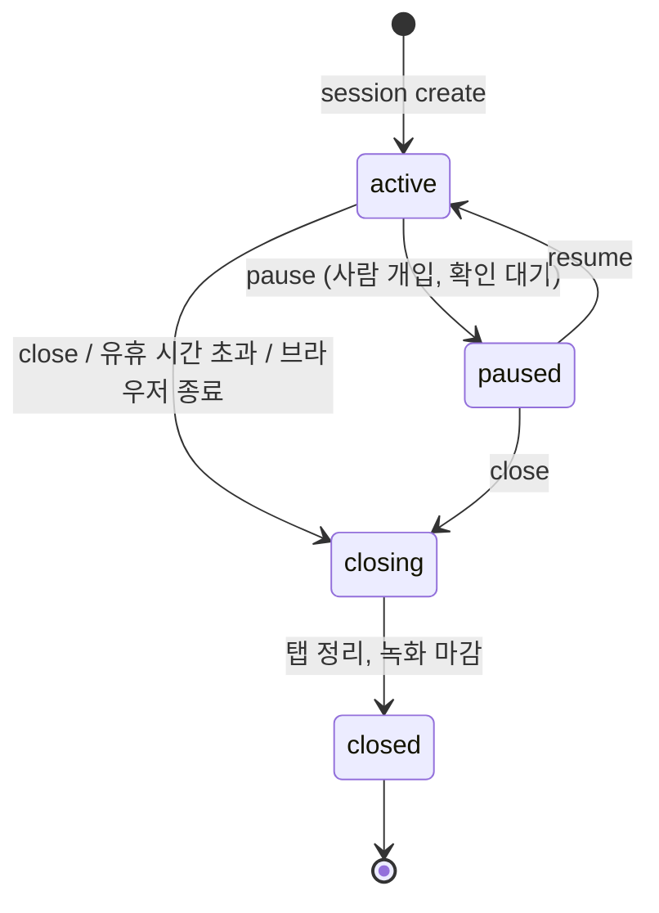
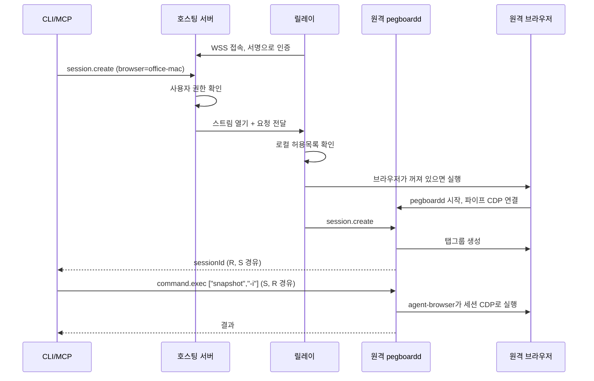

# pegboard-browser 아키텍처

- 작성일: 2026-11-10
- 상태: 사용자 승인 (2026-11-10). "사용자 결정"이라고 적힌 항목은 사용자가 직접 정한 것이고, 그 밖의 "결정"은 작성자가 제안해 문서와 함께 승인된 것이다. "결정(잠정)"과 [미확인] 항목은 0단계 검증 결과에 따라 바뀔 수 있다.
- 함께 읽을 문서: [roadmap.md](./roadmap.md), [open-questions.md](./open-questions.md)

## 표기 규칙

외부 프로젝트에 대한 서술에는 근거 수준을 붙인다.

- **[확인]**: agent-browser 저장소를 직접 읽어 확인했다. 기준은 `vercel-labs/agent-browser` 커밋 `e751995` (2026-11-09, v0.42.0).
- **[미확인]**: 기억이나 추정에 근거한다. 로드맵 0단계 스파이크에서 검증해야 한다.

결정 항목은 `결정 / 이유 / 버린 대안` 순서로 적는다. 사용자 답이 필요한 항목은 `→ Q번호`로 [open-questions.md](./open-questions.md)를 가리킨다.

---

## 1. 목표와 범위

### 만들려는 것

AI 에이전트가 제어하기 좋은 데스크톱 브라우저. 사람이 일상용으로 쓰는 브라우저 안에서, 에이전트가 사람과 분리된 프로필의 창에 자기 탭그룹을 받아 작업하고, 그 과정이 녹화되며, 같은 방식으로 원격 머신의 브라우저도 제어한다.

### 목표

1. 에이전트는 세션 단위로 브라우저를 제어한다. 세션은 탭그룹 하나에 대응한다.
2. CLI와 MCP가 같은 기능을 같은 코어로 제공한다.
3. 로컬 브라우저와 원격 브라우저를 같은 명령으로 다룬다.
4. 세션 중 일어난 일은 기본으로 기록된다.
5. Chromium 포크의 수정 범위를 작게 유지해 업스트림 추적 비용을 통제한다.

### 하지 않는 것 (현 설계 범위 밖)

- 스스로 목표를 세우고 일하는 자율 에이전트 내장. 이 브라우저는 외부 에이전트가 쓰는 도구다. 외부 에이전트의 요청을 빠르게 처리하려고 모델을 연결하는 보조 계층은 구상 단계로 다룬다(13절).
- 모바일 브라우저.
- 클라우드에서 브라우저를 대신 실행해 주는 호스팅 서비스. 원격 실행은 사용자가 가진 머신에 릴레이를 설치하는 방식만 다룬다.

### 실패로 간주할 것

- 에이전트가 사람의 프로필에 있는 탭, 로그인 상태, 설정에 닿을 수 있다.
- 에이전트가 다른 세션의 탭을 읽거나 조작할 수 있다.
- Chromium 보안 릴리스를 제때 따라가지 못할 만큼 패치가 커진다.
- 녹화에 비밀번호가 평문으로 남는다.

---

## 2. agent-browser 조사 결과

내장 방식을 정하는 근거다. 모두 **[확인]**이며 출처 파일을 함께 적는다.

### 구조와 제어 방식

| 항목 | 내용 | 출처 |
|---|---|---|
| 형태 | Rust로 작성된 네이티브 CLI 단일 바이너리. 라이브러리 타깃(`lib.rs`)은 없다. | `cli/Cargo.toml`, `cli/src/` |
| 라이선스 | Apache-2.0. axe-core 라이선스 파일을 별도로 동봉한다(내용은 읽지 않음). | `LICENSE`, `cli/src/native/a11y/` |
| 제어 프로토콜 | Chrome DevTools Protocol(CDP). Playwright 같은 중간 계층 없이 자체 CDP 클라이언트를 쓴다. | `cli/src/native/cdp/client.rs` |
| 프로세스 모델 | CLI가 명령을 백그라운드 데몬에 보낸다. `--session`마다 데몬 하나와 브라우저 하나. | `README.md`, `cli/src/native/daemon.rs` |
| CLI와 데몬 간 통신 | Unix는 유닉스 도메인 소켓, Windows는 루프백 TCP. 한 줄에 JSON 하나(`action` 필드)를 주고받는다. | `daemon.rs`, `connection.rs` |
| 브라우저 실행 | 기본은 Chrome for Testing을 내려받아 `--remote-debugging-port=0`으로 실행한다. | `cli/src/native/cdp/chrome.rs` |
| 기존 브라우저 접속 | `--cdp <포트\|ws URL>`, `--cdp-headers`(핸드셰이크 헤더), `--auto-connect`. | `docs/content/docs/cdp-mode.mdx` |
| MCP | `agent-browser mcp`가 stdio MCP 서버. 도구는 CLI 파서를 거쳐 자식 프로세스로 실행된다. `mcp call <tool> <json>`은 도구 하나를 상태 없이 실행한다. 도구 프로필(`core`, `network`, `state`, `debug`, `tabs`, `react`, `mobile`, `all`). | `cli/src/mcp.rs`, `commands.mdx` |
| 요소 지정 | `snapshot`이 접근성 트리를 텍스트로 돌려주고 요소마다 `@e1` 같은 ref를 붙인다. | `README.md` |

### 이 프로젝트 설계에 직접 영향을 주는 사실

1. **탭그룹 개념이 없다.** 소스에 탭그룹 관련 코드가 없고, 저장소에 동봉된 CDP 프로토콜 정의(`cli/cdp-protocol/browser_protocol.json`)에도 탭그룹 메서드가 없다. 세션과 탭그룹의 매핑은 우리가 만들어야 한다.
2. **공유 브라우저에서의 격리는 협조적이다.** `--pin-tab`은 세션을 탭 하나에 묶고 다른 세션이 그 탭을 가져가지 못하게 하지만(`tab_locked`), 핀이 걸리지 않은 탭, 즉 사람의 탭은 어느 세션이든 `tab <ref>`로 전환할 수 있다. 보안 경계로 쓸 수 없다. (`cdp-mode.mdx` "Tab pinning")
3. **`--cdp`로 붙으면 도메인 허용목록을 쓸 수 없다.** agent-browser는 `--allowed-domains`를 `--cdp`, `--auto-connect`, `--profile`, `--state`와 함께 쓰면 거부한다. 우리는 `--cdp`로 붙일 것이므로 도메인 제한은 직접 구현해야 한다. (`security.mdx` "Known limitations")
4. **보안 기능은 기본이 꺼져 있다.** 탐색·동작·출력 제한은 모두 옵트인이다. (`security.mdx`)
5. **녹화는 외부 ffmpeg가 필요하다.** `record`는 프레임을 `PATH`의 ffmpeg로 넘겨 WebM/MP4를 만들고, 활성 페이지 하나를 녹화한다. (`recording.mdx`, `cli/src/native/recording.rs`)
6. **세션마다 루프백 WebSocket 스트림 서버가 자동으로 뜬다.** 화면 프레임을 내보내고 마우스·키보드 입력을 받는다. 브라우저 클라이언트는 출처 검사를 받지만 로컬 네이티브 프로세스에 대한 인증은 문서에 없다. (`streaming.mdx`, `daemon.rs`)
7. **세션당 명령은 직렬 처리된다.** 데몬이 상태 뮤텍스를 잡고 명령을 처리한다. (`daemon.rs`)
8. **변화가 빠르다.** 버전 0.42.0, Vercel Labs 제품, 변경 이력 파일이 90KB를 넘는다. 내부 인터페이스에 의존하면 깨지기 쉽다.
9. **플러그인으로 브라우저 공급자를 붙일 수 있다.** `browser.provider` 플러그인은 CDP URL을 돌려주면 된다. (`plugins.mdx`)
10. **자격증명 금고가 있다.** 저장된 비밀번호는 LLM 컨텍스트에 들어가지 않는다. 페이지 출력에 경계 표식을 붙이는 `--content-boundaries`도 있다. (`security.mdx`)

---

## 3. 전체 구조

### 구성 요소

| 구성 요소 | 역할 | 구현 |
|---|---|---|
| **Pegboard 브라우저** | Chromium 포크. 사람이 일상용으로 쓰는 프로필과 에이전트 프로필을 함께 가진다. | C++ 패치 (최소) |
| **브리지** | 브라우저가 코어에 제공하는 내부 인터페이스. CDP 전체와 탭그룹 제어. | 포크 패치 (커스텀 CDP 도메인) |
| **코어 데몬 `pegboardd`** | 내장 에이전트 런타임의 본체. 세션과 에이전트 프로필 관리, 세션별 CDP 프록시, 정책, 녹화, 로컬 API. | Rust |
| **agent-browser** | 동작 엔진. 스냅샷, ref, 클릭, 입력 등. 업스트림 바이너리를 고정 버전으로 동봉. | 업스트림 그대로 |
| **CLI `pegboard`** | 에이전트와 사람이 쓰는 명령줄. | Rust (코어와 같은 바이너리) |
| **MCP 서버 `pegboard mcp`** | stdio MCP 서버. | Rust (같은 바이너리) |
| **릴레이 `pegboard relay`** | 원격 머신에 설치하는 상주 서비스. 호스팅 서버에 바깥 방향으로 연결해 그 머신의 브라우저를 띄우고 명령을 중계한다. | Rust (같은 바이너리) |
| **호스팅 서버** | 계정, 기기·릴레이 등록, 연결 중개, Pegboard 설정 동기화, 브라우저 동기화. 직접 띄우는 서버 하나. | Rust (별도 바이너리) |

### 다이어그램



### 통신 경로

| 경로 | 프로토콜 | 비고 |
|---|---|---|
| CLI/MCP → 로컬 `pegboardd` | 코어 API. 유닉스 소켓(Windows는 명명된 파이프) 위의 JSON-RPC 2.0, 한 줄에 메시지 하나 | 소유자만 접근 가능한 권한 |
| `pegboardd` → agent-browser | 자식 프로세스 실행. 공개 CLI 인터페이스(`--json`, `mcp call`)만 사용 | 데몬 소켓 프로토콜에는 의존하지 않는다 |
| agent-browser → 세션 CDP 프록시 | CDP. 루프백 WebSocket, 세션별 무작위 토큰을 `--cdp-headers`로 전달 | 세션이 가진 탭만 보인다 |
| 프록시 → 브라우저 | CDP 전체 + `Pegboard` 도메인. 3단계부터 파이프(1~2단계는 루프백 디버깅 포트) | 3단계부터 TCP 포트를 열지 않는다 |
| 릴레이 → 호스팅 서버 | 바깥 방향 WSS 상시 연결 | NAT 뒤에서도 동작 |
| CLI/MCP → 원격 `pegboardd` | 같은 코어 API를 호스팅 서버가 중개하는 터널에 실어 보낸다 | 로컬과 메시지가 같다 |
| 브라우저 ↔ 호스팅 서버 | HTTPS | Pegboard 설정 동기화, 브라우저 동기화(Chromium 동기화 프로토콜) |

---

## 4. 핵심 결정

### 결정 1. agent-browser는 무수정 바이너리로 동봉하고 별도 프로세스로 실행한다

**결정**: 업스트림 릴리스 바이너리를 버전과 체크섬으로 고정해 브라우저 패키지에 넣는다. `pegboardd`가 명령마다 `agent-browser --session <id> --cdp <세션 엔드포인트> --json ...` 형태로 실행한다. Pegboard 고유 기능(탭그룹, 격리, 녹화, 정책)은 agent-browser 바깥인 `pegboardd`와 CDP 프록시에 둔다.

**이유**
- 라이브러리 타깃이 없어 링크해서 쓸 수 없다 [확인].
- 변화가 빨라서 포크하면 병합 비용이 계속 든다 [확인]. Chromium 포크 하나만으로도 추적 부담이 크다.
- `--cdp`와 `--cdp-headers`가 있어 우리가 만든 CDP 엔드포인트에 그대로 붙일 수 있다 [확인].
- 공개 CLI와 `mcp call`은 문서화된 인터페이스라 데몬 내부 프로토콜보다 안정적이다.
- Apache-2.0이라 동봉과 재배포가 가능하다. 라이선스와 고지 파일을 함께 배포해야 한다.

**버린 대안**
- *agent-browser 포크*: 탭그룹과 격리를 그 안에 넣을 수 있지만, 격리를 클라이언트 쪽에 두면 보안 경계가 되지 못한다. 필요해지면 작은 패치만 얹는 포크로 물러설 수 있게 남겨 둔다.
- *Chromium 안에 C++로 재구현*: 포크 범위가 크게 늘고 agent-browser의 개선을 받을 수 없다.
- *agent-browser 데몬 소켓에 직접 접속*: 프로세스 실행 비용은 줄지만 내부 프로토콜에 묶인다.

**0단계 검증 결과 [확인]**: agent-browser는 전체 ws URL과 `--cdp-headers`만으로 붙고 HTTP 탐색을 하지 않는다. 토큰이 틀리면 실패하고 자체 브라우저를 띄우지 않는다. `close`는 CDP 메시지를 보내지 않고 탭을 남긴다. 세션마다 뜨는 스트림 서버는 `stream disable`로 끌 수 있다(11절).

### 결정 2. 격리는 세션별 CDP 프록시로 브라우저 쪽에서 강제한다

**결정**: `pegboardd`가 세션마다 CDP 엔드포인트를 하나씩 연다. 이 엔드포인트는 그 세션 탭그룹에 속한 타깃만 보여 주고, 그 밖의 타깃에 대한 명령은 거부한다. agent-browser는 자신이 브라우저 전체에 붙었다고 믿지만 실제로는 세션 범위만 본다.

프록시가 하는 일:
- 에이전트 프로필에 속하지 않은 타깃은 어떤 경우에도 통과시키지 않는다(결정 6). 아래 규칙은 그 안에서 세션을 나누는 것이다.
- `Target.getTargets`, `Target.targetCreated` 등에서 세션 소유가 아닌 타깃을 걸러 낸다.
- `Target.attachToTarget`, `Target.closeTarget` 등은 세션 소유 타깃에만 허용한다.
- **`Target.createTarget`은 브라우저에 그대로 넘기지 않는다.** CDP는 실제 프로필의 컨텍스트 ID로 탭을 만드는 것을 거부하고, 컨텍스트를 주지 않으면 "기본 컨텍스트"에 만드는데 그 기본이 사람 프로필일 수 있다 [확인: 0단계 A11]. 프록시가 이 명령을 가로채 브리지에게 "세션의 프로필 창, 세션 탭그룹에 탭을 만들라"고 시키고, 만들어진 타깃 ID를 응답으로 돌려준다. 만든 뒤 타깃의 `browserContextId`가 세션 프로필의 것인지 확인하고, 아니면 닫고 오류를 낸다.
- 세션 탭에서 `window.open` 등으로 열린 탭은 `openerId`로 세션 소유임을 판정한다. 같은 프로필과 같은 탭그룹에 자동으로 들어간다 [확인: 0단계 A5, A11].
- `Browser.close`처럼 브라우저 전체에 영향을 주는 메서드는 막거나 세션 범위 동작으로 바꾼다.
- **컨텍스트를 지정하지 않는 브라우저 수준 메서드는 기본 거부한다.** `Storage.getCookies`, `Storage.setCookies`, `Browser.grantPermissions` 등. 컨텍스트 없이 부른 `Storage.getCookies`가 사람 프로필의 쿠키를 돌려주었다 [확인: 0단계 A12]. 쿠키와 권한은 세션 탭에 붙은 페이지 세션의 메서드로만 다루게 한다. 페이지 세션의 쿠키 조회는 그 탭의 프로필 것만 나온다 [확인].
- 메서드는 허용목록 방식으로 통과시킨다. 모르는 메서드는 기본 거부. 출발점은 0단계에서 관찰한 23종이다([spike-findings.md](./spike-findings.md) A2).
- 세션 탭마다 `pegboardd` 자신의 CDP 세션을 하나 유지하고 거기에 `Emulation.setFocusEmulationEnabled`와 `Page.setWebLifecycleState { state: "active" }`를 건다. 가려진 탭에서 클릭이 5초 걸리고 화면 캡처가 멈추는 문제가 이것으로 없어진다 [확인: 0단계 A1]. 녹화도 이 세션을 쓴다.

**이유**
- agent-browser의 `--pin-tab`은 사람의 탭을 보호하지 못한다 [확인]. 에이전트는 신뢰할 수 없는 페이지 내용에 조종당할 수 있으므로 경계는 에이전트 바깥에 있어야 한다.
- 프록시가 CDP 길목에 있으면 정책 적용, 동작 로그, 녹화를 같은 자리에서 처리할 수 있다.
- 프록시를 브라우저 밖 Rust 프로세스에 두면 포크 패치가 늘지 않는다.

**버린 대안**
- *`--pin-tab`에 의존*: 위 이유로 경계가 되지 못한다.
- *세션마다 브라우저 인스턴스 분리*: agent-browser의 기본 모델이고 격리는 완전하지만 "세션 = 탭그룹"과 "사람의 브라우저 안에서 작업"이라는 요구를 버리게 된다.
- *Chromium 내부에서 타깃 필터링*: 가장 견고하지만 DevTools 내부를 건드리는 패치가 커진다. 프록시로 부족하다는 것이 드러나면 재검토한다.

**위험**: CDP 표면이 넓어 프록시의 허용목록에 구멍이 생길 수 있다. 기본 거부 원칙과, agent-browser가 실제로 쓰는 메서드만 여는 방식으로 줄인다.

### 결정 3. 브라우저와 코어 사이는 파이프 CDP와 커스텀 `Pegboard` 도메인으로 잇는다

**결정**: 브라우저는 시작할 때 `pegboardd`를 띄우고 파이프로 CDP 연결을 넘긴다. 탭그룹처럼 CDP에 없는 기능은 포크에 `Pegboard` 도메인을 추가해 제공한다. TCP 디버깅 포트는 열지 않는다.

**이유**
- 탭그룹 제어는 CDP에 없다 [확인: agent-browser가 동봉한 프로토콜 정의 기준. 최신 Chromium에서는 재확인 필요].
- TCP 디버깅 포트는 같은 머신의 모든 프로세스에 브라우저 전체 제어권을 준다. agent-browser 문서도 같은 경고를 한다 [확인].
- **포크 전(1~2단계)의 예외**: 순정 Chromium에서는 루프백 디버깅 포트를 쓴다. 0단계에서 검증한 구성이고, 파이프는 연결이 하나뿐이라 세션들을 겹쳐 싣는 다중화가 필요한데 아직 검증하지 않았다. 프록시의 브라우저 쪽 연결을 갈아 끼울 수 있게 두고 3단계에서 파이프로 바꾼다. 그때까지 이 브라우저에는 실제 계정을 넣지 않는다.
- 커스텀 도메인은 새 파일 위주로 추가되므로 업스트림 파일 수정이 적다.

**버린 대안**
- *내장 확장 프로그램 + `chrome.tabGroups`*: 포크 없이 가능해 MVP 단계에서는 이 방식을 쓴다(로드맵 1단계). 그룹 생성, 타깃 ID와 탭 ID 대응, 탭 추가가 모두 동작했다 [확인: 0단계 A5]. 최종 구조로는 버린다. 확장의 서비스 워커가 45초 쉬면 내려가 호출할 수 없게 되고 [확인], 명령줄로 올린 확장은 사람 프로필에도 로드되기 때문이다 [확인]. 1단계 브리지는 워커가 내려가지 않도록 `pegboardd`와의 연결을 유지해야 하며, 그 방식은 1단계 첫 작업에서 검증한다.
- *Chromium 내부 C++ API를 `pegboardd` 기능 전체에 직접 사용*: 코어를 브라우저 프로세스 안에 넣는 셈이라 포크 범위가 커진다.

**0단계 검증 결과**: 파이프 핸들러는 임의의 fd 쌍을 받도록 되어 있고 공개 함수만 fd 3, 4로 고정한다. 업스트림 파일 2개에 십여 줄을 더하면 될 것으로 보인다 [확인: 소스 읽기. 빌드로 검증하지는 않음]. 탭 생성과 프로필 창 열기도 이 도메인이 맡는다(결정 2, 6절).

### 결정 4. 원격 제어는 CDP가 아니라 명령 단위로 중계한다

**결정**: 원격 머신에서도 `pegboardd`와 agent-browser가 브라우저 옆에서 돈다. 네트워크를 건너는 것은 코어 API 메시지(명령 요청 하나, 응답 하나)뿐이다.

**이유**
- 스냅샷 한 번에 CDP 왕복이 여러 번 일어난다. CDP를 원격으로 터널링하면 지연이 곱으로 늘어난다.
- agent-browser의 명령 모델이 원래 요청 하나에 응답 하나다 [확인].
- 로컬과 원격이 같은 코어 API를 쓰므로 CLI와 MCP는 전송 계층만 바꾸면 된다.
- 녹화와 정책이 브라우저가 있는 머신에서 집행된다. 호스팅 서버가 뚫려도 원격 머신의 정책은 유지된다.

**버린 대안**
- *CDP 터널링*: 구현은 단순하지만 느리고, 원격 브라우저 전체 제어권이 네트워크를 건넌다.

### 결정 5. 코어·CLI·MCP·릴레이는 Rust 단일 바이너리의 역할로 만든다

**결정**: `pegboard` 바이너리 하나가 하위 명령으로 역할을 나눈다(`pegboard daemon`, `pegboard mcp`, `pegboard relay run`, 일반 CLI 명령). 호스팅 서버는 같은 작업공간의 별도 바이너리이고 프로토콜 타입 크레이트를 공유한다.

**이유**: 배포물이 하나라 브라우저 번들과 원격 머신 설치가 단순해진다. agent-browser도 Rust라 빌드 도구가 겹친다. 프로토콜 타입을 한 곳에서 정의할 수 있다.

**버린 대안**: *TypeScript/Node*: MCP 생태계는 넓지만 런타임을 브라우저에 동봉해야 한다. *Go*: 무난하지만 Rust를 버릴 이유가 없다.

이 결정은 작성자의 판단이다. 선호 언어가 따로 있으면 바꾼다.

### 결정 6. 사람과 에이전트는 프로필로 격리한다

**사용자 결정 (2026-11-10)**: 이 브라우저는 일상용으로도 쓴다. 일상 사용과 에이전트 사이에 공유할 것은 없고, 설정과 로그인 상태는 모두 격리한다. 한 브라우저에 두는 목적은 에이전트 화면을 쉽게 확인하는 것이다.

**결정**: 에이전트는 사람의 프로필과 분리된 **에이전트 프로필**에서만 동작한다. 에이전트 프로필은 자기 창을 따로 가지며, 세션은 그 창 안의 탭그룹이다. 사람의 프로필에 속한 탭은 에이전트에게 보이지 않고, 정책으로도 열 수 없다.

```
Pegboard 브라우저 (프로세스 하나)
 ├─ 사람 프로필 ── 창 ── 사람의 탭               에이전트 접근 불가
 └─ 에이전트 프로필 ── 창 ─┬─ 탭그룹 "조사" (세션 s_1)
                           └─ 탭그룹 "예약" (세션 s_2)
```

**이유**
- 프로필은 Chromium이 원래 제공하는 격리 단위다. 쿠키, 저장소, 방문 기록, 비밀번호, 확장 프로그램, 사이트 권한, 대부분의 설정이 프로필별로 나뉜다 [미확인: 기억 기반]. 데이터 격리를 위한 패치가 필요 없다.
- 가장 큰 잔여 위험이던 "조종당한 에이전트가 사람의 계정으로 행동한다"가 구조적으로 사라진다.
- 프록시의 격리 기준이 단순해진다. "에이전트 프로필의 타깃인가"를 먼저 보고, 그다음 "세션 탭그룹의 타깃인가"를 본다. 첫 기준은 탭을 끌어 옮겨도 바뀌지 않는다.
- 화면 확인 목적에 맞다. 에이전트 창을 사람 창 옆에 나란히 둘 수 있다.

**감수하는 것**
- 에이전트 탭그룹은 사람의 창 안에 있지 않고 에이전트 창에 있다. 창은 프로필 하나에 속하므로 [미확인] 한 창에 두 프로필의 탭을 섞을 수 없다.
- 사람이 보던 탭을 에이전트에게 넘겨줄 수 없다. 에이전트 프로필에서 주소를 다시 열어야 하고 로그인도 따로 해야 한다.
- 에이전트가 쓸 계정은 에이전트 프로필에서 한 번 로그인해 둔다. 사람이 에이전트 창에서 직접 로그인하면 된다.

**프로필로 격리되지 않는 것** (따로 다뤄야 한다)
- 브라우저 프로세스와 버전, `chrome://flags` 같은 브라우저 전체 설정 [미확인].
- OS 클립보드. 에이전트의 클립보드 읽기는 정책으로 막는다.
- 로컬 네트워크와 파일 시스템 접근. 에이전트 프로필의 다운로드 경로는 세션별 디렉터리로 고정한다.
- CDP 브라우저 연결. 프로세스가 하나라 두 프로필의 타깃이 같은 연결에 보일 수 있다 [미확인]. 그래서 결정 2의 프록시는 여전히 필요하다.

**버린 대안**
- *사람의 프로필을 공유*: 사용자 결정으로 제외.
- *브라우저 인스턴스를 따로 실행(사용자 데이터 디렉터리 분리)*: 격리는 가장 강하지만 프로세스가 둘이 되고, 브라우저 전체 설정까지 이중으로 관리한다. 프로필로 부족하다는 것이 드러나면 이쪽으로 물러선다.
- *세션마다 임시 컨텍스트(시크릿 방식)만 사용*: 로그인이 세션마다 사라진다. 선택 사항으로는 남긴다(아래).

**에이전트 세션끼리는 공유한다 (사용자 결정, 2026-11-10)**: 에이전트 프로필은 하나이고 모든 세션이 그것을 쓴다. 세션끼리 쿠키와 로그인 상태를 공유한다. 세션 사이의 구분은 탭 수준(탭그룹과 프록시)이다.

귀결: 한 세션이 조종당하면 에이전트 프로필의 모든 로그인에 닿을 수 있다. 에이전트 프로필에는 에이전트에게 맡겨도 되는 계정만 넣는다.

**필요하면 개별 프로필을 쓸 수 있다 (사용자 결정, 2026-11-10)**: 공유가 기본이고, 상황에 따라 CLI로 프로필을 만들어 세션을 거기에 붙인다. 자세한 것은 6절 "에이전트 프로필".

---

## 5. Chromium 포크 전략

이 절의 Chromium과 다른 포크 프로젝트에 대한 서술은 대부분 **[미확인]**(기억 기반)이다. 3단계 착수 전에 다시 조사한다.

### 대상 OS

**사용자 결정 (2026-11-10)**: macOS가 먼저다. macOS Developer ID가 있어 서명과 공증을 바로 할 수 있다. Windows는 코드 서명 인증서가 없어 뒤로 미룬다. 본인 사용이 목적이지만 배포 구성(서명, 공증, 설치 패키지, 자동 업데이트)까지 만든다.

작성자가 채운 순서: macOS arm64, 필요하면 macOS x64, 다음 Linux x64, 다음 Windows x64(인증서 확보 후). agent-browser는 macOS(arm64, x64), Linux(arm64, x64), Windows(x64) 바이너리를 제공하므로 [확인] 동작 엔진 쪽 제약은 없다. OS마다 서명, 설치 프로그램, 자동 업데이트를 따로 만들어야 하므로 한 번에 하나씩 늘린다.

### 포크 범위 최소화 원칙

1. **브라우저 밖으로 뺄 수 있으면 뺀다.** 세션, 프록시, 녹화, 정책, 원격은 모두 `pegboardd`에 있다. 포크는 브라우저만 할 수 있는 일만 한다.
2. **새 코드는 새 디렉터리에.** `//pegboard/` 아래에 두고 업스트림 파일에는 연결용 몇 줄만 넣는다.
3. **기존 확장 지점을 먼저 쓴다.** 명령줄 스위치, 엔터프라이즈 정책, 브랜딩 파일, 기능 플래그.
4. **패치마다 목적 하나.** 패치 하나가 기능 하나를 담당하고, 머리말에 목적과 건드리는 업스트림 파일을 적는다.
5. **패치 예산을 둔다.** 업스트림 파일 수정 줄 수를 지표로 추적하고 늘어나면 검토한다.

### 예상 패치 목록

| 패치 | 내용 | 업스트림 수정 정도 |
|---|---|---|
| 브랜딩 | 이름, 아이콘, 번들 ID, 사용자 데이터 디렉터리 | 작음 (브랜딩 파일 위주) |
| 코어 부트스트랩 | 시작 시 `pegboardd` 실행, 파이프 CDP 전달, 종료 시 정리 | 중간 |
| `Pegboard` CDP 도메인 | 탭그룹 생성·조회·소속 변경, 소속 변경 이벤트. 에이전트 프로필 생성·등록·삭제, 프로필 창 열기 | 작음 (새 파일 위주) |
| 에이전트 탭 표시 | 에이전트가 제어 중인 탭그룹의 시각적 표시 | 중간 (탭 UI) |
| ~~백그라운드 렌더링 유지~~ | 필요 없다. CDP 호출 두 개로 해결된다 [확인: 0단계 A1] | 없음 |
| 도메인 제한 | 탭그룹 단위 탐색 제한 (프록시에서 부족할 경우) | 미정 |
| 업데이트 | 자체 업데이트 경로. 구글 업데이트 인프라는 쓸 수 없다 | 큼 |
| 구글 서비스 정리 | 구글 로그인 UI 숨김 | 중간 |
| 비밀번호 관리자 끄기 | 내장 비밀번호 저장과 자동 채우기 비활성화 | 작음 (기본 설정값) [미확인] |
| 브라우저 동기화 | 동기화 서버 주소를 우리 서버로, 구글 계정 로그인을 우리 계정으로 교체. 암호화 기본 켜기 | 큼 (결정 7) |
| 북마크 프로필 | 북마크바가 선택된 폴더를 보여 주게 하고 왼쪽에 선택기 추가 | 중간 (결정 8, 14절) |

### 저장소와 패치 관리

**결정**: 이 저장소에는 Chromium 소스를 넣지 않는다. 고정한 Chromium 버전 태그, 순서 있는 패치 묶음(`patches/*.patch`), 새 소스 디렉터리(`pegboard/`), 빌드 스크립트만 둔다. 빌드할 때 Chromium을 받아 패치를 적용한다.

**이유**: Chromium 저장소는 매우 크다. 패치 묶음으로 두면 우리가 바꾼 것이 한눈에 보이고 리베이스가 "패치 다시 적용"으로 단순해진다. Brave, Electron, ungoogled-chromium이 비슷한 방식을 쓰는 것으로 안다 [미확인].

**버린 대안**: *Chromium 저장소 전체를 깃 포크해 브랜치로 관리*: 병합 이력이 복잡해지고 저장소 크기 부담이 크다.

### 업스트림 추적과 리베이스

**사용자 결정 (2026-11-10)**: 혼자 개발하고, Extended Stable을 따라간다.

- Extended Stable은 주 버전이 약 8주마다 바뀌는 것으로 안다 [미확인]. 주 버전이 바뀔 때 리베이스하고, 그 사이 보안 수정 릴리스도 따라간다. Stable(약 4주 [미확인])을 따를 때보다 리베이스가 절반이다.
- 보안 수정 릴리스는 나온 뒤 7일 안에 반영하는 것을 목표로 한다. 넘기면 브라우저에 구버전 경고를 띄운다. 7일은 작성자가 고른 출발점이다.
- 자동화가 전제다. 혼자서는 수작업 리베이스를 지속할 수 없다. 새 태그가 나오면 봇이 버전을 올리고 패치를 3-way로 적용해 본 뒤 빌드와 시험을 돌리고 결과를 보고한다. 충돌이 없으면 사람은 승인만 한다. 충돌은 사람이 푼다.
- 혼자 유지하므로 패치 예산을 엄격히 본다. 새 패치를 넣기 전에 브라우저 밖(`pegboardd`, 확장 프로그램, 정책 설정)에서 할 수 없는지 먼저 따진다.
- 브라우저 동기화 패치(결정 7)는 리베이스 부담이 가장 큰 후보다. 6단계에 들어가기 전에 그때까지의 리베이스 소요 시간을 보고 감당할 수 있는지 다시 판단한다.

### 빌드와 배포 파이프라인

```
버전 태그 고정 → Chromium 소스 받기 → 패치 적용 → pegboard/ 소스 배치
  → gn + ninja 빌드 → pegboard 바이너리와 agent-browser 동봉
  → 서명·공증 → 설치 패키지 → 업데이트 채널 게시
```

- Chromium 빌드는 무겁다. 15코어 맥에서 빈 상태부터 실행 가능한 브라우저까지 약 3시간 20분(전체 빌드 2시간 47분), 디스크 61GB가 들었다. 한 줄 수정 뒤 증분 빌드는 89초였다 [확인: 0단계 A10]. 소스와 산출물을 유지하는 전용 빌드 장비나 캐시가 붙은 자체 러너를 둔다. 빌드 중에는 그 기기를 다른 일에 쓰기 어렵다.
- 빌드 장비 준비물 [확인]: Xcode와 Metal 도구 모음(`xcodebuild -downloadComponent MetalToolchain`). 소스를 익명으로 받으면 요청 제한(HTTP 429)에 걸리므로 동시 요청 수를 낮추고 재시도한다.
- `pegboard` 바이너리(Rust)는 Chromium과 별도로 빌드해 패키징 단계에서 합친다. 코어 수정이 Chromium 재빌드를 부르지 않게 한다.
- agent-browser는 업스트림 릴리스 바이너리를 체크섬 검증 후 동봉한다.
- 서명: macOS는 보유한 Developer ID로 서명하고 공증한다. Windows는 코드 서명 인증서가 없어 그 OS를 지원할 때 마련한다.
- 공개와 라이선스 (사용자 결정, 2026-11-10): 저장소는 공개하고 이 프로젝트의 코드는 MIT로 배포한다. 업데이트 파일은 깃허브 릴리스에 둔다(작성자의 판단).
- 라이선스 고지: 배포물에는 MIT가 아닌 것이 들어 있다. agent-browser는 Apache-2.0이라 라이선스와 고지 파일을 함께 넣는다 [확인]. Chromium과 그 안의 제3자 코드는 각자의 라이선스를 따르고 브라우저의 크레딧 화면으로 고지한다 [미확인]. 우리 패치는 Chromium 파일을 고친 것이므로, 패치 파일의 라이선스 표기를 어떻게 할지는 3단계 전에 확인한다.
- 채널: `stable`과 `canary` 두 개로 시작한다.

### 위험

1. **백그라운드 탭 (0단계에서 해소).** 가려진 탭에서는 클릭이 약 5초 걸리고 화면 캡처 프레임이 오지 않았다. `pegboardd`가 탭마다 유지하는 CDP 세션에서 포커스 에뮬레이션과 수명 상태를 설정하면 정상이 된다. 플래그도 패치도 필요 없다 [확인]. 남은 것: 화면 잠금과 다른 데스크톱 공간에서의 동작은 확인하지 못했다. 포커스 에뮬레이션을 켠 탭은 가려져도 계속 그리므로 전력 소모가 늘 수 있다 [미확인].
2. **보안 릴리스 추적.** 브라우저는 뒤처지면 곧 위험해진다. agent-browser도 구버전 브라우저에 CVE 경고를 띄운다 [확인].
3. **구글 API 의존 기능.** 포크에서는 구글 동기화, 일부 안전 브라우징, DRM 등이 제한되는 것으로 안다 [미확인].

---

## 6. 세션 모델

### 세션이란

에이전트가 브라우저를 쓰는 작업 단위. 탭그룹 하나, CDP 엔드포인트 하나, 녹화 하나, 정책 하나를 가진다.

```
Session {
  id            "s_" + 무작위 문자열
  name          사람이 읽는 이름. 탭그룹 제목이 된다
  browser       로컬 또는 릴레이 이름
  profile       { name, kind: default | named | temp, copiedFrom? }
                사람의 프로필은 지정할 수 없다
  owner         세션을 만든 클라이언트 식별자
  tabGroup      { id, windowId, color }
  targets       이 세션이 소유한 탭의 타깃 ID 목록
  policy        적용 중인 정책
  recording     { enabled, path }
  state         active | paused | closing | closed
  createdAt, lastActivityAt
}
```

### 수명주기



- **생성**: 세션 프로필의 창이 없으면 연다. 브리지로 탭그룹과 첫 탭을 만든다. 세션 토큰과 CDP 엔드포인트를 발급한다. agent-browser 세션을 붙인 직후 `stream disable`을 실행한다(11절). 녹화를 시작한다.
- **종료**: 기본은 세션 탭을 닫고 탭그룹을 없앤다. 탭을 닫는 것은 `pegboardd`의 일이다. agent-browser의 `close`는 CDP로 붙은 세션에서 탭을 남긴다 [확인: 0단계 A2]. `--keep-tabs`를 주면 탭그룹을 풀어 탭을 에이전트 창에 남긴다. 녹화를 마감하고 토큰을 폐기한다.
- **유휴 시간 초과**: 명령이 일정 시간 없으면 종료한다. 기본값 1시간 제안(agent-browser 데몬의 기본 유휴 종료와 같다 [확인]).
- **브라우저 종료**: 모든 세션을 종료 처리한다. 브라우저를 다시 열어도 세션은 되살아나지 않는다. 탭그룹이 복원되더라도 에이전트 권한은 없다.
- **`pegboardd` 재시작**: 저장해 둔 세션과 타깃 대응을 브라우저의 실제 탭그룹과 대조해 복구한다. 대조에 실패한 세션은 종료한다.

### 에이전트 프로필

세션은 에이전트 프로필 하나에 속한다. 프로필은 세 종류다.

| 종류 | 만드는 법 | 수명 | 용도 |
|---|---|---|---|
| **기본** (`default`) | 처음 실행 때 자동 생성 | 영구 | 지정하지 않은 모든 세션. 로그인 상태를 공유한다 |
| **이름 있는 프로필** | `pegboard profile create <이름> [--from <프로필>]` | 지울 때까지 | 계정을 나눠야 하는 작업. 예: 고객사별, 계정별 |
| **임시 프로필** | `pegboard session create --temp-profile [--from <프로필>]` | 그 프로필을 쓰는 마지막 세션이 닫힐 때 삭제 | 한 번 쓰고 버릴 작업, 원본 로그인을 더럽히면 안 되는 작업 |

규칙:
- 프로필마다 창이 따로 열린다. 세션 탭그룹은 자기 프로필의 창에 생긴다. 창은 포크 전에는 실행 파일을 같은 사용자 데이터 디렉터리와 `--profile-directory=<이름>`으로 한 번 더 불러서 열고(약 0.45초 [확인: 0단계 A11]), 포크 뒤에는 `Pegboard` 도메인으로 연다.
- 어느 컨텍스트가 어느 프로필인지는 `pegboardd`가 창을 열 때 기록한다. 대조가 필요하면 그 컨텍스트의 탭에서 `chrome://version`의 프로필 경로를 읽는다 [확인].
- 같은 프로필의 세션끼리는 로그인 상태를 공유하고, 다른 프로필의 세션끼리는 공유하지 않는다.
- 프록시의 판정은 "이 세션의 프로필에 속한 타깃인가", 그다음 "이 세션 탭그룹에 있는가"다.
- `--from`을 주면 그 프로필을 복사해 시작한다. 주지 않으면 빈 프로필이다. 임시 프로필에서 `--from`을 생략하면 빈 프로필이다.
- **복사 원본은 에이전트 프로필만 된다. 사람의 프로필은 복사할 수 없다.** 사람의 로그인 상태가 에이전트로 넘어가는 유일한 길이 되기 때문이다(결정 6). 이 제한은 작성자의 판단이다.
- 임시 프로필은 세션을 닫을 때 지운다. 브라우저나 `pegboardd`가 비정상 종료해 남은 것은 다음 시작 때 지운다. 임시 프로필에서 생긴 로그인과 변경은 원본에 반영되지 않는다.
- 프로필은 브라우저별이다. 원격 브라우저의 프로필은 그 머신에 있고 `--browser`로 지정해 관리한다. 호스팅 서버로 동기화하지 않는다.
- 녹화의 `manifest.json`에 어떤 프로필을 썼는지, 임시였는지, 무엇을 복사했는지 남긴다.

**복사 방식**

**결정(잠정)**: 프로필 디렉터리를 캐시를 빼고 통째로 복사한다. 쿠키, 저장소, IndexedDB, 확장 프로그램 상태가 함께 간다.

**이유**: agent-browser가 같은 방식으로 Chrome 프로필을 임시 디렉터리에 복사해 쓴다. 캐시 디렉터리는 뺀다 [확인: `sessions.mdx` "Chrome profile reuse"]. 쿠키와 localStorage만 옮기는 방식보다 로그인 상태가 온전히 넘어간다.

**버린 대안**: *상태 내보내기와 불러오기(쿠키와 localStorage만)*: 깔끔하지만 IndexedDB나 서비스 워커에 의존하는 로그인은 넘어가지 않는다. 디렉터리 복사가 안 되는 경우의 대비책으로 남긴다.

**위험과 한계**
- 열려 있는 프로필의 복사는 동작한다. 원본이 계속 쓰는 중에도 6회 모두 성공했고, 브라우저를 끄지 않고 복사본을 열고 지울 수 있었다 [확인: 0단계 A13]. 실험은 2.8MB짜리 빈 프로필이었으므로 실제로 쓰던 큰 프로필에서의 일관성은 1~2단계에서 다시 확인한다.
- **쿠키가 디스크에 쓰이기까지 30초가 걸렸다** [확인]. 복사 직전 30초 안에 생긴 로그인은 복사본에 없을 수 있다. 대응: 복사 전에 원본 프로필의 쿠키를 페이지 세션의 CDP로 읽어 두고, 복사본을 연 뒤 빠진 것을 넣는다. 이 보완이 필요한지는 2단계에서 정한다.
- 실행 중인 브라우저에 새 프로필을 등록하는 일은 브리지가 해야 한다 [미확인: 프로필 목록은 브라우저 전체 상태 파일에 있는 것으로 기억한다]. 디렉터리만 만든다고 프로필이 되지 않을 수 있다.
- 로그인 토큰이 두 곳에서 쓰인다. 토큰을 갱신할 때마다 바꾸는 사이트에서는 복사본이나 원본 한쪽이 로그아웃될 수 있다. 막을 방법이 없으므로 문서로 알린다.
- 복사본에는 원본의 모든 로그인이 들어 있다. 임시 프로필이라고 권한이 좁아지는 것은 아니다.

### 세션과 탭그룹의 매핑

- 세션 하나에 탭그룹 하나. 탭그룹은 에이전트 프로필의 창에 만든다. 창이 없으면 세션 생성 때 연다. 탭그룹 제목은 세션 이름, 색은 세션마다 다르게.
- **접근 권한의 기준은 두 겹이다.** 프록시는 먼저 "에이전트 프로필의 타깃인가"를, 다음으로 "이 세션 탭그룹에 있는가"를 본다.
- 에이전트가 연 탭, 그리고 세션 탭에서 `window.open`이나 `target=_blank`로 열린 탭은 세션 탭그룹에 들어간다.
- 세션 탭에서 열린 팝업 창은 별도 창이라 탭그룹에 넣을 수 없다. 세션 소유로 추적하되 탭그룹 밖 예외로 다룬다.

### 사람의 탭과의 경계

- 경계는 프로필이다(결정 6). 사람의 프로필에 있는 탭, 쿠키, 설정은 에이전트에게 존재하지 않는 것과 같다.
- 에이전트는 창의 포커스를 가져오지 않는다. 에이전트 창이 사람 창 앞으로 올라오지 않는다.
- 사람은 언제든 에이전트 창을 보고 조작할 수 있다. 로그인을 대신 해 주는 경우가 대표적이다. 조작이 감지되면 세션에 "사람 개입" 표시가 붙고 에이전트의 다음 응답에 그 사실이 실린다.
- 사람의 탭을 에이전트에게 넘겨주는 기능은 없다. 프로필이 다르면 탭을 옮길 수 없다.
- 에이전트 창 안에서 사람이 탭을 탭그룹 사이로 옮겨도 소속은 바뀌지 않는다. 1단계에서 세션의 범위는 타깃 ID로 정해지므로 옮긴 탭은 원래 세션이 계속 조종하고, 그 탭이 들어간 그룹의 세션을 닫으면 그룹 구성원으로서 함께 닫힌다("소속은 탭을 따라가지 그룹을 따라가지 않는다"). 그룹을 따라 소속을 바꿀지는 2단계에서 정한다 [미정]. 같은 에이전트 프로필 안의 일이라 사람 쪽 자료가 넘어갈 위험은 없다.
- 에이전트 창에서 사람이 탭그룹 밖에 연 탭은 어느 세션에도 속하지 않아 에이전트에게 보이지 않는다.
- 다운로드는 세션별 디렉터리로 간다. 파일 업로드는 정책에서 허용한 경로만 가능하다.

### 여러 에이전트가 동시에 붙을 때

- 세션마다 토큰이 다르고 엔드포인트가 다르다. 세션끼리 서로의 타깃이 보이지 않는다.
- 한 세션 안의 명령은 직렬 처리한다. agent-browser 데몬도 세션당 직렬이다 [확인].
- 서로 다른 세션의 명령은 병렬로 실행된다.
- 한 세션을 여러 클라이언트가 함께 쓰려면 같은 세션 ID로 접근한다. 소유자 검사를 통과해야 한다.
- 쿠키와 저장소는 같은 에이전트 프로필을 쓰는 세션끼리 공유된다(결정 6). 세션 사이는 탭 수준 격리이지 데이터 수준 격리가 아니다. 이것은 의도한 동작이다.

---

## 7. CLI와 MCP

### 공유 코어 구조

```
            ┌──────────┐   ┌───────────┐
            │   CLI    │   │ MCP 서버  │      얇은 프런트엔드
            └────┬─────┘   └─────┬─────┘
                 └───────┬───────┘
                 ┌───────▼────────┐
                 │  클라이언트     │   코어 API 호출, 대상 브라우저 해석
                 │  라이브러리     │
                 └───────┬────────┘
              ┌──────────┴───────────┐
       ┌──────▼──────┐        ┌──────▼──────┐
       │ 로컬 전송    │        │ 터널 전송    │     같은 메시지, 다른 전송
       │ (유닉스 소켓)│        │ (WSS)       │
       └──────┬──────┘        └──────┬──────┘
              ▼                      ▼
          pegboardd            원격 pegboardd
```

CLI와 MCP는 인자와 출력 형식만 다루고, 동작은 전부 `pegboardd`의 코어 API가 한다. 새 기능은 코어 API에 먼저 추가하고 두 프런트엔드에 같이 노출한다. agent-browser도 CLI와 MCP의 동등성을 규칙으로 둔다 [확인: `AGENTS.md`].

### 대상 브라우저 지정

- `--browser <대상>` 또는 환경 변수 `PEGBOARD_BROWSER`. MCP 도구에서는 `browser` 인자.
- 값: `local`(기본), 릴레이 이름(예: `office-mac`).
- 세션을 만들 때만 대상을 지정한다. 세션 ID가 어느 브라우저에 있는지는 클라이언트가 기억하므로 이후 명령은 `--session`만 주면 된다.
- `--session`도 생략하면 환경 변수 `PEGBOARD_SESSION`을 쓴다.

### CLI 명령 초안

```
# 브라우저
pegboard browser list                       사용할 수 있는 브라우저 (로컬 + 릴레이)
pegboard browser start|stop [--browser B]   브라우저 실행·종료
pegboard browser status [--browser B]

# 세션
pegboard session create [--name N] [--browser B] [--url U]
                        [--profile P | --temp-profile [--from P]]
                        [--record on|off] [--policy FILE]
pegboard session list [--browser B]
pegboard session info  <id>
pegboard session close <id> [--keep-tabs]
pegboard session pause|resume <id>

# 에이전트 프로필
pegboard profile list [--browser B]
pegboard profile create <name> [--from P] [--browser B]   빈 프로필 또는 복사본
pegboard profile info <name>                              쓰는 세션, 크기, 복사 원본
pegboard profile open <name>                              창 열기 (사람이 직접 로그인할 때)
pegboard profile delete <name>                            쓰는 세션이 있으면 거부

# 브라우저 동작 (agent-browser 명령을 그대로 받는다)
pegboard [--session S] open <url>
pegboard [--session S] snapshot [-i]
pegboard [--session S] click @e1
pegboard [--session S] fill @e2 "text"
pegboard [--session S] <그 밖의 agent-browser 명령>

# 녹화
pegboard recording list [--session S] [--failed]
pegboard recording show <id>          요약과 동작 로그
pegboard recording open <id>          재생 화면 열기
pegboard recording export <id> --format webm|zip
pegboard recording delete <id>
pegboard recording prune [--older-than 14d]

# 원격
pegboard login | logout | whoami
pegboard relay enroll --server URL    이 머신을 릴레이로 등록
pegboard relay install | uninstall    상주 서비스 설치·제거
pegboard relay run | status

# 그 밖
pegboard config get|set|sync
pegboard mcp [--tools core,...]
pegboard doctor
```

**동작 명령 통과 규칙**: `pegboard`는 agent-browser의 동작 명령을 그대로 넘기되, 접속 대상과 실행 환경을 바꾸는 전역 플래그는 거부한다. 거부 대상: `--cdp`, `--auto-connect`, `--provider`, `--profile`, `--executable-path`, `--args`, `--extension`, `--state`, `--config`, `--engine`. 에이전트가 이 플래그로 세션 밖 브라우저에 붙는 것을 막기 위해서다. `session`, `close`, `record`, `install`, `upgrade`, `connect`처럼 Pegboard가 맡는 명령은 가로채서 Pegboard 쪽 동작으로 바꾼다.

### MCP 도구 초안

Pegboard 고유 도구:

| 도구 | 인자 | 결과 |
|---|---|---|
| `pegboard_browser_list` | 없음 | 브라우저 목록과 상태 |
| `pegboard_profile_list` | `browser?` | 에이전트 프로필 목록 |
| `pegboard_profile_create` | `name`, `from?`, `browser?` | 프로필 정보 |
| `pegboard_session_create` | `name?`, `browser?`, `url?`, `record?`, `profile?`, `tempProfile?`, `tempProfileFrom?` | `sessionId`, 탭그룹 정보 |
| `pegboard_session_list` | `browser?` | 세션 목록 |
| `pegboard_session_info` | `sessionId` | 세션 상태, 탭 목록, 사람 개입 여부 |
| `pegboard_session_close` | `sessionId`, `keepTabs?` | 녹화 ID |
| `pegboard_recording_list` | `sessionId?` | 녹화 목록 |
| `pegboard_recording_get` | `recordingId` | 요약과 동작 로그 |

브라우저 동작 도구는 agent-browser의 MCP 도구 목록을 그대로 중계한다. agent-browser가 타입이 붙은 도구 목록과 프로필을 이미 갖고 있고, `mcp call`로 도구 하나를 상태 없이 실행할 수 있기 때문이다 [확인]. `pegboard mcp`는 도구 호출을 받아 `sessionId`를 확인한 뒤 브라우저가 있는 머신의 `pegboardd`에 넘기고, 거기서 `agent-browser mcp call`을 실행한다. 접속을 바꾸는 공용 인자(`extraArgs` 등)는 걸러 낸다.

도구 스키마 예:

```json
{
  "name": "pegboard_session_create",
  "description": "브라우저에 에이전트 세션을 만든다. 세션은 탭그룹 하나에 대응한다.",
  "inputSchema": {
    "type": "object",
    "properties": {
      "name":     { "type": "string", "description": "탭그룹 제목으로 쓰일 세션 이름" },
      "browser":  { "type": "string", "description": "local 또는 릴레이 이름. 기본 local" },
      "url":      { "type": "string", "description": "첫 탭에서 열 주소" },
      "record":   { "type": "boolean", "default": true },
      "profile":  { "type": "string", "description": "에이전트 프로필 이름. 기본 default" },
      "tempProfile": { "type": "boolean", "default": false,
                    "description": "세션이 닫히면 지워지는 임시 프로필에서 실행. profile과 함께 쓸 수 없다" },
      "tempProfileFrom": { "type": "string",
                    "description": "임시 프로필의 복사 원본. 생략하면 빈 프로필" }
    }
  }
}
```

도구 이름을 `agent_browser_*` 그대로 둘지 `pegboard_*`로 바꿀지는 작은 결정이다. 제안: 그대로 둔다. 에이전트가 agent-browser의 스킬 문서를 그대로 활용할 수 있다.

### 코어 API 메시지 초안

JSON-RPC 2.0, 한 줄에 메시지 하나.

```json
{"jsonrpc":"2.0","id":1,"method":"session.create",
 "params":{"name":"가격 조사","url":"https://example.com","record":true}}

{"jsonrpc":"2.0","id":1,
 "result":{"sessionId":"s_8fk2","tabGroup":{"id":12,"title":"가격 조사","color":"blue"}}}

{"jsonrpc":"2.0","id":2,"method":"command.exec",
 "params":{"sessionId":"s_8fk2","argv":["snapshot","-i"],"timeoutMs":30000}}

{"jsonrpc":"2.0","id":2,
 "result":{"exitCode":0,"output":{"success":true,"data":{"snapshot":"..."}},
           "humanIntervened":false}}
```

| 메서드 | 설명 |
|---|---|
| `browser.status`, `browser.start`, `browser.stop` | 브라우저 수명 |
| `profile.list`, `profile.create`, `profile.info`, `profile.open`, `profile.delete` | 에이전트 프로필 |
| `session.create`, `session.list`, `session.info`, `session.close`, `session.pause`, `session.resume` | 세션 |
| `command.exec` | agent-browser 명령 실행 |
| `mcp.listTools`, `mcp.callTool` | 동작 도구 중계 |
| `recording.list`, `recording.get`, `recording.read`, `recording.delete` | 녹화 |
| `confirm.respond` | 확인이 필요한 동작에 대한 승인·거부 |
| 알림: `session.changed`, `confirm.required` | 서버에서 클라이언트로 |

---

## 8. 녹화

### 무엇을 기록하는가

| 종류 | 내용 | 기본값 | 수집 지점 |
|---|---|---|---|
| **동작 로그** | 명령, 인자(민감 값 가림), 결과 요약, 시각, 소요 시간, 대상 탭과 주소 | 켜짐 | `pegboardd` (모든 명령이 지나간다) |
| **화면** | 세션 탭의 화면 프레임 | 켜짐 | 프록시와 별개의 CDP 세션에서 화면 캡처 |
| **탐색 기록** | 탭별 주소 변화, 탭 열림·닫힘 | 켜짐 | CDP 이벤트 |
| **네트워크** | 요청·응답의 메타데이터(주소, 상태, 크기, 시간) | 꺼짐 | CDP 네트워크 이벤트 |
| **네트워크 본문** | 요청·응답 본문 | 꺼짐. 명시적으로 켜야 함 | 같음 |
| **콘솔** | 콘솔 메시지와 페이지 오류 | 꺼짐 | CDP 이벤트 |
| **사람 개입** | 사람이 세션 탭을 조작한 시점 | 켜짐 | 입력 이벤트 감지 |

동작 로그가 중심이다. 화면은 동작 로그의 시각에 맞춰 붙는 보조 자료다.

### 화면 기록 방식

**결정**: `pegboardd`가 세션 탭마다 CDP 화면 캡처를 직접 받아, 화면이 바뀐 프레임만 JPEG로 저장하고 시각 색인을 남긴다. 영상 파일(WebM)은 내보낼 때 만든다.

**이유**
- agent-browser의 `record`는 외부 ffmpeg가 `PATH`에 있어야 하고 활성 페이지 하나만 녹화한다 [확인]. 세션에 탭이 여러 개일 수 있고, 사용자에게 ffmpeg 설치를 요구할 수 없다.
- 에이전트 작업은 화면이 멈춰 있는 시간이 길다. 변화 프레임만 저장하면 작다.
- 프레임 단위 저장이라 특정 동작 직전·직후 화면을 바로 찾을 수 있다.

**버린 대안**
- *agent-browser `record` 사용*: 위 이유.
- *DOM 변화 기록(rrweb 방식)*: 용량이 가장 작고 텍스트 검색이 되지만, 페이지에 스크립트를 주입해야 해서 사이트의 보안 정책과 충돌할 수 있고, 페이지의 모든 텍스트가 기록에 남아 민감 정보 처리가 더 어렵다.
- *OS 화면 캡처*: 사람의 탭과 다른 앱까지 찍힌다.

**위험**: 가려진 탭에서는 화면 캡처 프레임이 오지 않을 수 있다 [미확인]. 5절의 백그라운드 탭 위험과 같은 문제다.

### 저장 형식과 위치

```
<사용자 데이터 디렉터리>/recordings/<recordingId>/
  manifest.json        세션 정보, 형식 버전, 시작·종료 시각, 정책, 가림 규칙
  actions.jsonl        동작 로그. 한 줄에 동작 하나
  navigation.jsonl     탐색 기록
  screen/<targetId>/
    index.jsonl        { ts, file, url, width, height }
    000001.jpg ...
  network.har          켰을 때만
  console.jsonl        켰을 때만
```

`actions.jsonl` 한 줄의 예:

```json
{"seq":14,"ts":"2026-11-10T05:12:03.412Z","sessionId":"s_8fk2","targetId":"A1B2",
 "url":"https://example.com/login","command":"fill",
 "args":{"selector":"@e3","text":"[가림: password]"},
 "ok":true,"durationMs":182,"frameBefore":"000031.jpg","frameAfter":"000032.jpg"}
```

- 위치는 브라우저가 있는 머신의 로컬 디스크다. 원격 세션의 녹화는 원격 머신에 남는다.
- 녹화는 호스팅 서버로 올라가지 않는다. 원격 녹화를 보려면 터널을 통해 필요할 때 가져온다.
- 디렉터리 권한은 소유자 전용. 저장 시 암호화는 선택 사항으로 둔다.

### 재생

- `pegboard recording open <id>`가 재생 화면을 연다. 동작 목록과 화면이 시간축으로 맞물리고, 동작을 누르면 그 시점 화면으로 이동한다.
- 재생 화면은 정적 웹 페이지로 만들어 `pegboardd`가 루프백에서 일회용 토큰과 함께 제공한다. 포크 이후에는 브라우저 내부 페이지로 옮길 수 있다.
- `recording export --format webm`은 프레임을 영상으로 묶는다. 이때만 인코더가 필요하다.
- `recording show`는 화면 없이 동작 로그만 텍스트로 보여 준다. 에이전트가 자기 작업을 되짚을 때 쓴다.

### 보존 기간

**사용자 결정 (2026-11-10)**: 녹화의 주된 용도는 디버깅이다.

14일이 지났거나 전체 용량이 5GB를 넘으면 오래된 것부터 지운다. 둘 다 설정으로 바꿀 수 있다. 특정 녹화를 "보관"으로 표시하면 자동 삭제에서 빠진다. 숫자는 작성자가 고른 출발점이다.

디버깅 용도이므로 하지 않는 것: 변조 방지(서명, 해시 사슬), 장기 보존, 고화질 영상 우선. 화면은 무슨 일이 있었는지 알아볼 수 있는 화질이면 충분하고, 저장 용량을 줄이는 쪽을 택한다.

디버깅 용도이므로 챙기는 것: 실패한 동작의 직전과 직후 화면, 그 시점의 오류 메시지와 스냅샷 요약을 동작 로그에서 바로 찾을 수 있게 한다. 실패한 세션의 녹화는 `recording list --failed`로 골라 볼 수 있게 한다.

### 민감 정보 처리

| 대상 | 처리 |
|---|---|
| 비밀번호 입력란에 넣는 값 | 동작 로그에서 가린다. 입력란 종류는 명령 실행 전에 프록시가 확인한다 |
| 자격증명 금고로 하는 로그인 | 비밀번호가 명령 인자에 아예 나타나지 않는다 [확인: agent-browser 금고]. 로그인은 이 경로를 권장한다 |
| 카드 번호, 일회용 코드 입력란 | `autocomplete` 속성으로 판별해 로그에서 가린다 |
| 화면 속 비밀번호 | 입력란이 원래 가려져 표시된다. "비밀번호 보기"를 누른 경우는 막지 못한다 |
| 화면 속 그 밖의 민감 정보 | 도메인 단위 규칙으로 화면 기록을 끈다. 예: 은행 사이트에서는 동작 로그만 남긴다 |
| 네트워크 헤더 | `Authorization`, `Cookie`, `Set-Cookie`는 항상 가린다 |
| 네트워크 본문 | 기본으로 기록하지 않는다 |
| `eval` 결과, 스냅샷 본문 | 동작 로그에는 요약과 크기만 남긴다. 전문 저장은 선택 사항 |

한계: 화면에 보이는 정보를 완전히 가리는 방법은 없다. 그래서 녹화는 로컬에만 두고, 접근을 통제하고, 보존 기간을 짧게 잡는 것을 기본으로 한다.

---

## 9. 릴레이

### 역할

원격 머신에 설치하는 상주 서비스. 세 가지를 한다.

1. 호스팅 서버에 바깥 방향 연결을 유지한다.
2. 요청이 오면 그 머신의 Pegboard 브라우저를 띄우고 끈다.
3. 터널로 들어온 코어 API 메시지를 로컬 `pegboardd`에 넘기고 응답을 돌려보낸다.

릴레이 자체는 브라우저를 제어하지 않는다. 제어는 그 머신의 `pegboardd`가 한다.

### 원격 머신의 종류

**사용자 결정 (2026-11-10)**: 화면이 있는 데스크톱(사무실 PC, 집의 맥)을 대상으로 한다. 릴레이는 로그인한 사용자의 세션에서 돌고, 브라우저 창이 실제 화면에 뜬다. 프로필 창과 탭그룹이 로컬과 똑같이 동작한다.

귀결: 원격 머신에 사용자가 로그인해 있어야 한다. 화면 잠금 상태에서 창이 그려지고 자동화가 되는지는 확인하지 않았다 [미확인]. 가려진 창 문제(A1)와 같은 검증에서 함께 본다.

화면이 없는 서버는 초기 범위 밖이다. 가상 디스플레이나 헤드리스가 필요하고 그 환경에서 창과 탭그룹이 어떻게 동작하는지 모른다 [미확인].

### 설치

```
# 원격 머신에서
1. Pegboard 브라우저 설치 (pegboard 바이너리가 함께 들어 있다)
2. pegboard relay enroll --server https://pegboard.example.com
     → 화면에 짧은 코드가 나온다
3. 사용자가 자기 계정으로 그 코드를 승인한다 (웹 또는 pegboard relay approve <코드>)
4. pegboard relay install
     → 사용자 단위 상주 서비스로 등록
        macOS: LaunchAgent / Linux: systemd 사용자 서비스 / Windows: 로그온 시 작업
```

사용자 단위 서비스로 두는 이유: 브라우저는 로그인한 사용자의 데스크톱 세션에서 떠야 하고, 릴레이에 관리자 권한을 줄 이유가 없다.

### 호스팅 서버와의 연결, NAT 통과

**결정**: 릴레이가 호스팅 서버로 WSS 연결을 열어 유지한다. 클라이언트도 서버로 연결하고, 서버가 둘 사이의 스트림을 이어 준다. 모든 트래픽이 서버를 거친다.

**이유**: 바깥 방향 TCP 443 연결은 대부분의 NAT와 방화벽을 통과한다. 원격 머신에 포트를 열 필요가 없다. 결정 4 덕분에 오가는 것이 명령과 응답뿐이라 서버 경유 지연이 문제 되지 않는다.

**버린 대안**
- *직접 연결(홀 펀칭, WebRTC 데이터 채널)*: 지연과 서버 부하가 줄지만 구현과 디버깅이 어렵고, 실패 시 어차피 중계가 필요하다. 원격 화면 실시간 보기에서 필요해지면 그때 추가한다.
- *SSH나 기존 VPN에 의존*: 호스팅 서버 없이도 되는 가장 싼 방법이다. 버리지 않고 보조 전송으로 둔다(`--browser ssh://user@host`). 릴레이 관리, 상태 표시, 권한 모델은 제공하지 못한다.

연결 유지: 주기적 핑, 끊기면 지수 백오프로 재접속. 재접속해도 원격 머신의 세션은 `pegboardd`에 살아 있으므로 이어서 쓸 수 있다.

### 인증

- **릴레이 등록**: 등록할 때 릴레이가 키 쌍을 만들고 공개 키를 서버에 등록한다. 개인 키는 OS 키 저장소에 둔다.
- **릴레이 접속**: 서버가 보낸 난수에 개인 키로 서명해 증명한다. 재사용 가능한 비밀 값을 주고받지 않는다.
- **클라이언트 접속**: 사용자 토큰(기기 승인 흐름으로 발급). 범위와 만료가 있다.
- **권한 확인은 두 번**: 서버가 "이 사용자가 이 릴레이를 쓸 수 있는가"를 확인하고, 릴레이도 터널에 실려 온 사용자 신원을 자기 로컬 허용목록과 대조한다.

### 원격 브라우저 실행과 제어 흐름



### 터널 메시지 초안

```json
{"v":1,"type":"hello","relayId":"r_31ab","version":"0.1.0",
 "capabilities":["browser.launch","recording.read"],"os":"macos-arm64"}

{"v":1,"type":"open","stream":"st_77","from":"u_alice","scope":["session","command"]}
{"v":1,"type":"data","stream":"st_77","payload":"<코어 API 메시지>"}
{"v":1,"type":"close","stream":"st_77","reason":"client_closed"}
{"v":1,"type":"ping"}
```

`payload`는 종단 간 암호화를 쓸 경우 암호문이 된다(11절).

---

## 10. 호스팅 서버

### 하는 일

1. **계정**: 가입, 로그인, 토큰 발급.
2. **기기 등록**: 브라우저 설치본과 릴레이를 계정에 묶는다.
3. **릴레이 상태**: 접속 여부, 버전, 마지막 접속 시각, 실행 중인 브라우저.
4. **연결 중개**: 클라이언트와 릴레이 사이 스트림을 잇는다.
5. **동기화**: Pegboard 설정과 브라우저 자료. 아래 범위.

### 동기화 범위

**사용자 결정 (2026-11-10)**: 비밀번호 저장은 브라우저에 두지 않고 확장 프로그램(Bitwarden, 1Password 등)에 맡긴다. 그 밖의 항목은 크롬처럼 동기화한다.

동기화는 성격이 다른 두 갈래로 나뉜다.

**(가) Pegboard 설정 동기화**: 에이전트와 관련된 설정. 양이 적고 우리가 만든 자료다.

| 항목 | 동기화 |
|---|---|
| 에이전트 정책(도메인 허용목록, 동작 정책, 확인 대상) | 한다 |
| 녹화 설정(무엇을 기록할지, 보존 기간, 가림 규칙) | 한다 |
| 릴레이 목록과 별명 | 한다 |

원칙: **서버에서 내려온 정책은 로컬 정책을 조일 수만 있고 풀 수는 없다.** 각 머신의 로컬 설정이 상한이다. 방식은 항목별 버전 번호를 두고 마지막 쓰기가 이긴다.

**(나) 브라우저 동기화**: 사람의 프로필에 있는 일반 브라우저 자료. 크롬 동기화에 해당한다.

| 항목 | 동기화 | 비고 |
|---|---|---|
| 북마크, 방문 기록, 열린 탭, 탭그룹 | 한다 | |
| 브라우저 환경설정, 테마, 검색 엔진 | 한다 | |
| 확장 프로그램 목록과 그 설정 | 한다 | 비밀번호 관리 확장도 이 경로로 다른 기기에 설치된다 |
| 주소 자동 완성 | 한다 | |
| 비밀번호, 패스키 | **하지 않음. 기능 자체를 끈다** | 내장 비밀번호 관리자를 비활성화하고 확장 프로그램에 맡긴다 |
| 결제 수단 | 하지 않음 | 크롬에서도 구글 결제에 묶인 기능이다 [미확인]. 작성자의 판단 |
| 쿠키, 로그인 상태 | 하지 않음 | 크롬 동기화도 옮기지 않는다 [미확인] |

**에이전트 프로필은 브라우저 동기화 대상이 아니다.** 사람의 프로필만 동기화한다. 에이전트 프로필은 머신마다 따로 두고 (가)의 설정만 받는다. 작성자의 판단이다.

**어떤 것도 동기화하지 않는 것**: 녹화(8절), 에이전트 프로필의 내용.

#### 결정 7. 브라우저 동기화는 Chromium의 동기화 엔진을 그대로 쓰고 서버만 우리 것으로 바꾼다

이 결정의 근거는 모두 [미확인]이다. 3단계 착수 전 조사에서 확인한다.

**결정(잠정)**: Chromium에 들어 있는 동기화 클라이언트를 유지하고, 접속 대상을 구글 서버에서 우리 호스팅 서버로 바꾼다. 호스팅 서버가 Chromium 동기화 프로토콜을 구현한다. 자료는 동기화 암호문으로 올려 서버가 내용을 볼 수 없게 한다.

**이유**
- 북마크, 방문 기록, 탭, 확장 프로그램, 환경설정의 병합과 충돌 처리는 Chromium 안에 이미 있다. 다시 만들면 수년치 일이다.
- 구글의 동기화 서버는 구글 빌드가 아닌 Chromium에서 쓸 수 없는 것으로 안다. 그래서 서버는 직접 운영해야 한다.
- Brave가 이 방식으로 자체 동기화 서버를 운영하고 그 서버 코드를 공개한 것으로 안다. 참고하거나 가져다 쓸 수 있는지 조사한다.
- Chromium 동기화에는 사용자 암호로 자료를 암호화하는 기능이 있는 것으로 안다. 이것을 기본으로 켜면 종단 간 암호화가 된다.

**버린 대안**
- *동기화를 직접 구현(확장 프로그램 API나 CDP로 북마크 등을 읽어 옮기기)*: 포크 패치는 없지만 병합 품질이 떨어지고 항목마다 따로 만들어야 한다.
- *동기화 서비스를 제공하지 않고 북마크 내보내기 등으로 대신*: 사용자 요구와 맞지 않는다.

**비용과 위험**
- **이 프로젝트에서 포크 다음으로 큰 일이다.** 동기화 클라이언트는 구글 계정 로그인에 묶여 있다. 로그인 부분을 우리 계정 체계로 바꾸는 패치가 필요하고, 업스트림이 자주 바뀌는 영역이라 리베이스 부담이 크다.
- 동기화 프로토콜은 공개 표준이 아니라 Chromium 내부 규격이다. Chromium 버전이 오르면 서버도 따라가야 한다.
- 브라우저 동기화가 들어오면 호스팅 서버는 "작은 중개 서버"가 아니게 된다. 저장량과 가용성 요구가 달라진다.

### 비밀번호와 확장 프로그램

- 내장 비밀번호 관리자를 끈다. 저장 제안, 자동 채우기, 설정 화면의 비밀번호 항목을 숨긴다. Chromium에 이를 끄는 정책 설정이 있는 것으로 안다 [미확인]. 있으면 기본값만 바꾸는 작은 패치로 끝난다.
- 확장 프로그램은 크롬 웹 스토어에서 설치한다. 포크에서도 웹 스토어 설치가 되는 것으로 안다 [미확인].
- **위험**: 1Password처럼 데스크톱 앱과 연동하는 확장은 앱이 브라우저의 코드 서명을 확인해 허용 목록에 있는 브라우저만 받는 것으로 안다 [미확인]. 그렇다면 Pegboard에서는 데스크톱 앱 연동(지문 잠금 해제 등)이 안 되고 확장 단독으로만 쓸 수 있다. Bitwarden은 확장 단독으로 동작한다.
- **에이전트 프로필에는 비밀번호 관리 확장을 설치하지 않는 것을 기본으로 한다.** 잠금이 풀린 비밀번호 관리자가 에이전트 프로필에 있으면 조종당한 에이전트가 모든 비밀번호에 닿을 수 있다. 에이전트의 로그인은 사람이 에이전트 창에서 직접 하거나 agent-browser의 자격증명 금고를 쓴다. 확장 프로그램은 프로필별이므로 사람 프로필에만 설치하면 된다 [미확인].

### 계정과 권한 모델

**사용자 결정 (2026-11-10)**: 개인 계정만 둔다. 계정 하나가 자기 기기와 릴레이를 소유한다.

팀으로 확장할 때의 초안:

```
조직 ─┬─ 구성원 (역할: 소유자 / 관리자 / 구성원)
      └─ 릴레이 ── 접근 권한: { 사용자 또는 그룹, 수준 }
                    수준: 보기(상태·녹화 열람) / 사용(세션 생성·제어) / 관리(정책·삭제)
```

토큰 종류: 사용자 토큰(사람이 로그인), 에이전트 토큰(범위와 만료를 좁힌 자동화용), 릴레이 자격(키 쌍).

### 자체 호스팅

**사용자 결정 (2026-11-10)**: 직접 띄우는 서버 하나로 운영한다. 여러 사람이 가입하는 서비스는 만들지 않는다. 서버는 단일 바이너리이고 저장소는 SQLite로 시작하며, 컨테이너 이미지를 제공한다. 클라이언트와 릴레이는 서버 주소를 설정으로 받는다.

**이유**: 이 서버는 사용자의 브라우저 제어 경로에 놓인다. 남이 운영하는 서버를 믿지 않아도 되게 하는 것이 제품 성격에 맞다. 단일 바이너리와 SQLite는 운영형 서비스로 키울 때도 출발점으로 쓸 수 있다.

**버린 대안**: *운영형 서비스 전용*: 다중 테넌트, 과금, 운영 부담이 처음부터 생긴다.

### 서버 API 초안

```
POST /v1/auth/device/start          기기 승인 흐름 시작
POST /v1/auth/device/token          토큰 교환
GET  /v1/me
POST /v1/relays/enroll              등록 시작 (코드 발급)
POST /v1/relays/enroll/approve      코드 승인
GET  /v1/relays                     릴레이 목록과 상태
PATCH /v1/relays/{id}               별명, 접근 권한
DELETE /v1/relays/{id}
GET  /v1/config                     Pegboard 설정 (버전 포함)
PUT  /v1/config/{key}
(Chromium 동기화 프로토콜 경로)       브라우저 동기화. 형식은 Chromium 규격을 따른다
WSS  /v1/tunnel/relay               릴레이 상시 연결
WSS  /v1/tunnel/client?relay={id}   클라이언트 스트림
```

---

## 11. 보안

### 위협과 대응

| 위협 | 대응 |
|---|---|
| 페이지 내용이 에이전트를 조종한다(프롬프트 주입) | 페이지 출력에 경계 표식을 기본으로 붙인다 [확인: agent-browser `--content-boundaries`]. 세션 범위 밖으로는 나갈 수 없게 한다(결정 2) |
| 조종당한 에이전트가 사람의 탭이나 로그인 상태를 쓴다 | 프로필 격리(결정 6)와 CDP 프록시. 사람 프로필의 타깃은 어떤 정책으로도 열리지 않는다. 탭 생성은 프록시가 가로채 에이전트 프로필에 만들고, 프로필을 지정하지 않는 브라우저 수준 메서드는 거부한다(결정 2) |
| 조종당한 에이전트가 에이전트 프로필에 로그인된 계정으로 파괴적 동작을 한다 | 동작 정책과 확인 절차. 완전히 막을 수는 없다(아래 "남는 위험") |
| 조종당한 에이전트가 다른 세션의 탭을 읽는다 | 세션별 CDP 프록시. 탭그룹 밖 타깃은 보이지 않는다. 쿠키는 같은 프로필이면 공유된다 |
| 에이전트가 시스템 클립보드를 읽거나 쓴다 | `--allow clipboard`가 없으면 프로필 단위 권한 거부, 가드가 넣는 캡처 리스너, 키 조합 거부(2a, 아래 "남는 위험") |
| 에이전트가 자료를 외부로 보낸다 | 세션별 도메인 허용목록. agent-browser의 것은 `--cdp` 접속에서 쓸 수 없으므로 [확인] `pegboardd`의 요청 가드(`guard.rs`)가 구현한다(2a): 자기 연결의 브라우저 수준 자동 연결로 에이전트 프로필의 모든 탭, 팝업, 다른 사이트 iframe, 워커가 첫 요청 전에 멈추고, 요청 가로채기(`Fetch`)를 건 뒤에 재개된다. 요청마다 주소 규칙(`address.rs`)으로 판정하고, 이름은 데몬이 풀어 그 주소로 다시 판정한다. 웹소켓은 문서에 붙이는 CSP로 막는다. 에이전트 쪽 연결은 가로채기를 끄거나 가리는 메서드를 쓸 수 없다(`GUARD_METHODS`) |
| 같은 머신의 다른 프로세스가 브라우저를 제어한다 | TCP 디버깅 포트는 3단계부터 열지 않는다(1~2단계는 루프백 포트를 쓴다. 아래 "남는 위험"). 코어 API는 소유자 전용 소켓. 세션 CDP 엔드포인트는 루프백에 무작위 토큰. agent-browser의 스트림 서버는 세션 시작 직후 끈다 |
| 호스팅 서버가 뚫린다 | 서버는 정책을 풀 수 없다. 릴레이가 로컬 허용목록으로 다시 확인한다. 종단 간 암호화(선택) |
| 릴레이 자격이 유출된다 | 개인 키는 OS 키 저장소에. 서버에서 릴레이를 폐기할 수 있다 |
| 녹화가 유출된다 | 로컬 저장, 소유자 전용 권한, 민감 값 가림, 짧은 보존, 선택적 암호화 |
| 동봉한 agent-browser가 변조된다 | 버전과 체크섬 고정, 브라우저 패키지와 함께 서명 |

### 에이전트 권한 범위

세션마다 정책 하나가 붙는다. 세 층으로 나눈다.

1. **범위(항상 강제)**: 자기 탭그룹의 타깃만. 프록시가 강제하며 정책으로 풀 수 없다.
2. **도메인**: 허용목록 또는 차단목록. 탐색과 하위 요청에 적용.
3. **동작**: agent-browser의 동작 분류를 그대로 쓴다 [확인]: `navigate`, `click`, `fill`, `eval`, `download`, `upload`, `snapshot`, `scroll`, `wait`, `read`, `get`, `interact`, `network`, `state`. 분류마다 허용, 확인 필요, 거부 중 하나.

기본 정책 (사용자 결정, 2026-11-10: 대부분 허용, 일부만 확인):

| 분류 | 기본 |
|---|---|
| `navigate`, `click`, `fill`, `snapshot`, `scroll`, `wait`, `read`, `get`, `interact` | 허용 |
| `eval` | 허용 (많은 작업에 필요하다. 엄격 모드에서는 확인) |
| `download` | 허용, 세션 디렉터리로만 |
| `upload` | 확인 필요 |
| `network`(요청 가로채기), `state`(쿠키·저장소 쓰기) | 확인 필요 |
| 프로필 전체 쿠키 읽기 | 거부 (정책으로도 풀 수 없음) |

확인이 필요한 동작은 브라우저에 승인 창을 띄우고, 코어 API의 `confirm.required` 알림으로도 내보낸다. agent-browser는 대기 중인 확인을 60초 뒤 자동 거부한다 [확인].

**정책 판정은 `pegboardd`가 한다.** 명령을 agent-browser에 넘기기 전에 분류하고 허용, 확인, 거부를 정한다. agent-browser의 `--action-policy`와 `--confirm-actions`에는 기대지 않는다. 0.42.0은 문서의 분류명(`eval`)이 아니라 내부 동작명(`evaluate`, `url`)으로 매칭해서, 문서의 예시 `{"deny":["eval"]}`이 `eval`을 막지 못했다 [확인: 0단계 A8]. 위 표의 분류는 우리가 명령 이름에서 직접 매핑한다.

### 릴레이와 서버 간 인증과 암호화

- 전송: TLS 1.3. 릴레이와 클라이언트는 서버 인증서를 검증한다. 자체 호스팅을 위해 사용자 지정 CA를 받는다.
- 릴레이 인증: 등록 때 만든 키 쌍으로 난수 서명.
- 클라이언트 인증: 범위와 만료가 있는 토큰.
- **종단 간 암호화 (사용자 결정, 2026-11-10: 형식만 대비하고 구현은 미룬다)**: 클라이언트와 릴레이가 서로의 공개 키로 세션 키를 합의해 터널 `payload`를 암호화하면 서버는 명령과 페이지 내용을 볼 수 없다. 페이지 내용에는 로그인된 계정의 자료가 포함되므로 가치가 크다. 대신 키 배포와 기기 추가 절차가 복잡해진다. 터널 메시지 형식은 처음부터 암호문을 실을 수 있게 만든다. 서버가 본인 것이라 구현은 미루고, 남이 운영하는 서버를 쓰게 되면 그 전에 넣는다. 브라우저 동기화 자료는 이와 별개로 처음부터 암호화한다(결정 7).

### 녹화 데이터 접근 통제

- 로컬: 파일 권한으로 소유자만. 코어 API의 `recording.*`은 소켓 소유자 검사를 통과해야 한다.
- 에이전트: 자기 세션의 녹화만 읽을 수 있다. 다른 세션의 녹화는 사용자 권한이 필요하다.
- 원격: `recording.read`는 릴레이의 로컬 허용목록에서 별도 권한이다. 세션을 제어할 수 있다고 해서 녹화를 볼 수 있는 것은 아니다.
- 서버: 녹화를 저장하지도 중간에 보관하지도 않는다.
- 삭제: 녹화 삭제는 프레임 파일까지 지운다. 보존 기간이 지난 것은 `pegboardd`가 시작할 때와 주기적으로 지운다.

### 남는 위험

- 에이전트 프로필에 로그인해 둔 계정에 대해서는, 조종당한 에이전트가 그 계정으로 행동할 수 있다. 피해 범위는 에이전트 프로필에 넣어 둔 계정으로 한정된다. 정책, 확인, 도메인 허용목록으로 줄인다.
- 프로필 격리는 같은 프로세스 안의 격리다. 프록시가 프로필 경계를 잘못 판정하면 사람의 타깃이 노출된다. 이 판정은 가장 먼저, 가장 단순한 코드로 하고 시험으로 고정한다.
- 클립보드는 프로필과 무관하게 OS 전체가 공유한다. 2a(작업 7)부터 `--allow clipboard`가 없는 세션의 프로필에는 세 가지를 건다 [측정: 2a C1~C12, E2, E3]. (1) 프로필이 기본 컨텍스트일 때 데몬의 전용 연결로 `Browser.setPermission {clipboard-read, clipboard-write: denied, browserContextId}`를 걸고 연결을 유지한다(연결이 끊기면 명령을 거부하고 다시 건다. 클립보드를 허용하는 세션이 그 프로필을 쓰게 되면 그 프로필을 기본으로 만들어 `Browser.resetPermissions`로 푼 뒤 연결을 닫는다. 연결을 닫기만 해서는 풀리지 않았다: 작업 7 실제 브라우저 시험). (2) 요청 가드가 자기 브라우저 수준과 페이지 수준 자동 연결(`waitForDebuggerOnStart`)로 멈춘 모든 탭, 팝업, 프레임에 재개 전에 `Page.addScriptToEvaluateOnNewDocument`로 `L_hard2`(시작 때 저장한 `preventDefault`, `stopImmediatePropagation`, `addEventListener`를 `Reflect.apply`로 부르는 창과 문서의 `copy`/`cut`/`paste`/`before*` 캡처 리스너)를 넣고, 멈추지 않고 붙은 프레임(`sandbox` `srcdoc`)에는 `runImmediately`로 실행 중인 문서에도 넣고, 그 문서의 스크립트가 먼저 돌았으므로(그 문서의 캡처 리스너가 먼저 이벤트를 멈추면 복사가 됐다: 측정) 그 프레임 안에서 `location.reload()`로 다시 읽게 한다(탭 하나에 8개까지)(`guard::CLIPBOARD_SHIELD`, `clipboard_step`). (3) `press`의 복사, 잘라내기, 붙여넣기 조합은 `argv::class_of`가 `clipboard`로 분류해 거부한다. 남는 구멍: 리스너는 문서 안에서 먼저 도는 쪽이 이기므로 가드의 세션이 에이전트 세션보다 오래되어야 한다(C12a). 새 타깃은 가드가 먼저 붙어 멈춰 두므로 보장된다고 보고(시험 `agent_scripts_cannot_run_before_the_shield`), 가드가 다시 붙을 때는 클립보드를 거부하는 세션들의 에이전트 연결을 먼저 끊어(`ProxyServer::drop_clients`, 에이전트는 다시 붙는다) 가드보다 오래된 에이전트 세션이 남지 않게 한 뒤, 그 전부터 있던 그 프로필들의 탭에 리스너를 넣고 새로 고친다. 에이전트의 `Page.addScriptToEvaluateOnNewDocument`는 agent-browser의 `vitals`가 쓰므로 거부하지 않았다(계획의 K3를 뺐다). 끊은 연결의 세션을 브라우저가 떼어 내는 시점은 기다리지만(0.3초) 확인하지는 않는다. 오른쪽 클릭 메뉴와 사람의 입력은 재지 않았다. 가드는 리스너를 넣으려고 그 탭에서 `Page.enable`을 하는데, 이것이 페이지 대화 상자 처리에 주는 영향은 따로 재지 않았다.
- 다운로드(2a 작업 5): 수동 확인 M5(2026-11-13)에서 에이전트가 받은 파일이 macOS 사용자의 `~/Downloads`에 저장되는 것을 발견해 1단계에서는 막았다. 2a부터는 프로필마다 데몬 전용 연결로 `Browser.setDownloadBehavior {allowAndName, eventsEnabled}`를 걸어 데몬만 아는 임시 폴더로 받게 하고, 다운로드를 시작한 탭(주 프레임은 탭의 타깃 ID, 팝업은 연 탭, 다른 사이트 iframe은 iframe 타깃의 `parentFrameId`, 그 밖에는 탭의 프레임 트리)으로 세션을 찾아 그 세션의 파일 디렉터리로 옮긴다 [측정: 2a L, E, F]. 세션을 알 수 없거나, 세션이 `--deny download`이거나, 한도(파일 200 MiB, 세션 1 GiB)를 넘거나, 그 사이 세션이 닫힌 다운로드는 지운다. 정책을 건 연결이 끊기면 그 프로필의 명령을 거부하고 다시 건다(5초 안에 못 하면 그 프로필의 세션을 닫는다). 실제 브라우저 시험: `download_lands_in_the_session_files_dir_only`, `deny_download_writes_no_file_anywhere`, `unattributed_download_is_deleted`, `download_policy_is_reapplied_after_its_connection_drops` 등.
- 1~2단계에는 브라우저의 루프백 디버깅 포트가 열려 있다. 같은 사용자로 도는 로컬 프로세스는 `DevToolsActivePort` 파일을 읽어 브라우저 전체(사람 프로필 포함)에 붙을 수 있다. 3단계에서 파이프로 바꿀 때까지 이 브라우저에는 실제 계정을 넣지 않는다.
- CDP 프록시의 허용목록에 빠진 경로가 있을 수 있다. 기본 거부로 시작하고, 프록시를 우회하는 시도를 시험 항목으로 유지한다.
- agent-browser 세션마다 루프백 스트림 서버가 기본으로 뜨고, 인증 없이 접속해 화면을 받을 수 있었다 [확인: 0단계 A9]. `pegboardd`는 세션을 붙인 직후 `stream disable`을 실행한다. 그래도 첫 명령부터 끄기까지 짧은 구간은 열려 있다. 시작부터 끄는 설정은 찾지 못했다. 업스트림에 옵션을 제안하거나, 필요하면 작은 패치를 얹는다.
- 포크 전(1~2단계)에는 브리지 확장 프로그램이 명령줄로 로드되어 사람 프로필에도 올라간다 [확인: 0단계 A12]. 이 확장은 탭과 디버거 권한을 가지므로, 에이전트 프로필의 탭만 다루도록 만들고 3단계에서 내장 브리지로 바꾸며 없앤다.
- Windows에서 agent-browser 데몬은 루프백 TCP로 명령을 받는다 [확인]. 다중 사용자 Windows 머신에서의 노출을 확인해야 한다.
- 주소 규칙(2a)은 요청 단계에서 이름과 데몬이 푼 주소로 판정한다. Chrome은 응답이 페이지에 간 뒤에야 실제 원격 주소를 알려 주므로 [확인: 2a G2, G3], 브라우저가 데몬과 다르게 이름을 풀면(DNS-over-HTTPS, DNS rebinding) 사설 주소에 닿을 수 있고 그 요청의 부작용은 막지 못한다.
- 웹소켓과 EventSource는 `Fetch`에 보이지 않는다 [확인: 2a B1]. 가드는 문서를 다시 내려 주며 `Content-Security-Policy: connect-src`를 붙여 막는다. 허용목록이 없으면 CSP로 "사설망만 빼고"를 말할 수 없어 `wss:`는 어디로든 열린다. 최상위 `data:`와 `about:blank` 문서, 서비스 워커가 응답한 문서, 스크립트 주소로 만든 전용 워커에는 CSP가 붙지 않는다(그런 문서에서 에이전트가 `eval`로 연 웹소켓 포함). 다운로드가 아닌 응답은 형식과 상관없이 문서로 보고 CSP를 붙인다: 그림이나 평문 문서도 같은 출처 페이지가 `frames[0]`으로 그 안에서 스크립트를 돌릴 수 있기 때문이다(재검토 N1). 응답 단계에서 헤더만 바꾸는 `Fetch.continueResponse`로는 CSP가 적용되지 않으므로 [확인: 2a 3라운드 B2 V3] 본문을 다시 내려 준다. 본문은 16 MiB까지 조각으로 읽고, 모든 탭을 합쳐 128 MiB(바이트로 셈), 프로필당 32 MiB, 문서당 20초를 넘으면 그 문서를 실패시킨다. 한 프로필의 페이지가 같은 프로필의 다른 문서를 그 몫만큼 늦추거나 실패시킬 수 있다. 정책이 허용한 루프백이나 사설망 주소(데몬이 푼 주소)에서 온 문서도 다시 내려 주지 않는다: 다시 내려 준 문서는 주소 공간을 잃고, Chrome은 보안 출처가 아닌 그런 문서의 로컬 요청을 거절한다 [확인: 2a 작업 4 2라운드]. 그 문서들의 웹소켓은 주소 규칙 밖이다(사용자 결정, 2026-11-14). WebTransport와 WebRTC는 재지 않았다.
- 서비스 워커의 주 스크립트 요청은 가로채기에 거의 잡히지 않는다 [확인: 2a D2, 10번 중 0~1번]. 판정 대상에서 빠진다.
- 에이전트 프로필에 Chrome의 로컬 네트워크 접근 권한을 주지 않는다(검토 결정, 2026-11-14). 공개 주소의 문서는 순정 Chrome처럼 localhost와 사설망에 닿지 못하고, Chrome이 연결할 때 하는 자신의 주소 검사도 살아 있다(이 검사가 공개 페이지의 웹소켓까지 막는지는 순정 Chrome에서 따로 재지 않았다).
- 사람 프로필의 새 타깃도 브라우저 수준 자동 연결로 시작 때 데몬의 응답 한 번만큼 멈춘다. 공유 워커와 서비스 워커 안의 중첩 워커는 자동 연결되지 않는다. `--no-localhost`는 허용목록이 있을 때도 적용된다.
- 에이전트 쪽 연결이 새 팝업에 붙어 가드가 `Fetch.enable`을 하기 전에 `Page.navigate`를 보낼 수 있는지(경주)는 재지 않았다.
- 가드의 브라우저 연결이 끊기면 Chrome이 가로채기를 푼다 [확인: 2a G5]. 다시 붙을 때까지 데몬은 모든 세션의 명령을 거부하지만, 이미 열린 페이지의 스크립트는 그동안 판정 없이 요청을 낼 수 있다.

---

## 12. 미확인 가정 모음

0단계 스파이크의 입력이다. 판정의 근거는 [spike-findings.md](./spike-findings.md). 그 문서의 "설계 변경 제안" 9건은 사용자 승인을 받아 본문에 반영했다(2026-11-10).

| # | 가정 | 틀리면 | 판정 (2026-11-10) |
|---|---|---|---|
| A1 | 가려진 탭에서도 CDP 자동화와 화면 캡처가 쓸 만하게 동작한다(또는 플래그나 패치로 그렇게 만들 수 있다) | 세션 모델을 다시 생각해야 한다. 가장 큰 위험 | 조건부. CDP 호출 2개로 해결 |
| A2 | CDP 프록시로 타깃을 걸러도 agent-browser가 정상 동작한다 | agent-browser에 패치를 얹거나 프록시 방식을 바꾼다 | 맞다 |
| A3 | agent-browser가 전체 ws URL과 `--cdp-headers`만으로 우리 엔드포인트에 붙는다 | 프록시가 HTTP 탐색 경로도 구현한다 | 맞다 |
| A4 | 최신 CDP에도 탭그룹 제어가 없다 | 있으면 `Pegboard` 도메인이 작아진다 (좋은 쪽) | 맞다 (Chrome 157) |
| A5 | 확장 프로그램의 `chrome.tabGroups`와 타깃 ID 대응으로 포크 없이 탭그룹을 제어할 수 있다 | 1단계 MVP가 포크를 필요로 한다 | 조건부. 서비스 워커 수명 처리 필요. 1단계에서 확인: 브리지가 `pegboardd`와 연결을 유지해 2분 유휴 뒤에도 응답하고 (`bridge_still_answers_after_two_minutes_idle`), 탭그룹 생성과 탭 추가가 동작하며 (`group_and_tabs_land_in_agent_profile`, `create_opens_group_in_agent_window`), 사람 프로필의 타깃은 거부한다 (`bridge_refuses_targets_of_the_human_profile`) |
| A6 | 브라우저가 자식 프로세스에 파이프 CDP를 넘기는 패치가 작다 | `pegboardd`가 브라우저의 부모가 되는 구성으로 바꾼다 | 맞다 (소스 읽기 기준) |
| A7 | CDP로 만든 별도 브라우저 컨텍스트는 같은 창의 탭그룹에 넣을 수 없다 | 넣을 수 있으면 세션별 쿠키 격리가 가능해진다 (좋은 쪽) | 맞다 |
| A11 | 브라우저 수준 CDP 연결에서 타깃이 어느 프로필 것인지 확실히 구분할 수 있고, 특정 프로필에 탭과 창을 만들 수 있다 | 프로필 격리 대신 브라우저 인스턴스 분리로 물러선다 | 조건부. 탭 생성 가로채기로 대응 (결정 2) |
| A13 | 열려 있는 프로필의 디렉터리를 복사해 새 프로필로 등록하면 로그인 상태가 유지된 채 동작한다. 브라우저를 끄지 않고 프로필을 만들고 지울 수 있다 | 복사를 상태 내보내기 방식으로 바꾸거나, 복사 전에 원본 프로필 창을 잠시 닫는다 | 맞다. 쿠키 반영 30초 주의 |
| A14 | Chromium 동기화 클라이언트를 우리 서버에 붙일 수 있고, 구글 계정 의존을 감당할 만한 패치로 떼어 낼 수 있다. 3단계 전 조사에서 확인 | 동기화 범위를 줄이거나 직접 구현으로 물러선다 | 3단계 전 조사 |
| A15 | 포크에서 크롬 웹 스토어 확장 설치가 되고 Bitwarden, 1Password 확장이 동작한다. 3단계 전 조사에서 확인 | 확장 설치 경로를 따로 마련한다. 데스크톱 앱 연동은 포기할 수 있다 | 3단계 전 조사 |
| A12 | 프로필별로 쿠키, 저장소, 확장 프로그램, 사이트 권한, 설정이 나뉜다. 나뉘지 않는 항목의 목록을 만든다 | 새는 항목마다 대응을 정한다 | 목록 작성, 일부 미실시. 1단계에서 확인: 쿠키와 localStorage는 프로필별로 분리되어 에이전트가 사람 프로필의 값을 읽지 못한다 (`agent_cannot_read_human_cookies_or_storage`), 에이전트 프로필끼리도 분리된다 (`sessions_in_different_profiles_share_nothing`), 같은 프로필의 세션은 쿠키를 공유한다 (`sessions_in_one_profile_share_cookies_but_not_tabs`). 환경설정(홈 버튼, 기본 검색엔진, 다운로드 위치)은 프로필별로 나뉜다(수동 확인 M4, 2026-11-13). 다운로드 경로는 수동 확인 M5에서 기대와 달랐다(에이전트 프로필의 받은 파일이 `~/Downloads`에 생김). 에이전트 프로필의 다운로드를 막아 고쳤고 어디에도 저장되지 않는다(`agent_download_writes_no_file`, `download_policy_survives_reconnects`, `agent_cannot_reenable_downloads`). 사람 프로필은 그대로다(`human_downloads_still_work`) |
| A8 | agent-browser의 동작 정책·확인이 `--cdp` 접속에서 동작한다 | `pegboardd`가 직접 판정한다 | 조건부. 내부 동작명으로만 매칭 |
| A9 | agent-browser의 세션별 스트림 서버를 끌 수 있다 | 업스트림에 기여하거나 작은 패치를 얹는다 | 조건부. 끌 수 있으나 기본은 켜짐 |
| A10 | Chromium 전체 빌드를 가진 장비로 감당할 수 있다 | CI 예산과 빌드 캐시 계획을 먼저 세운다 | 맞다. 전체 2시간 47분, 증분 89초 |

---

## 13. 모델 연동 (구상 단계)

- 상태: 구상. 구체적인 사용 사례가 없는 상태에서 사용자가 낸 발상을 구조로 옮겨 본 것이다. 로드맵에 일정을 잡지 않았다.
- 발상: 브라우저에 API 키나 Ollama, LM Studio 같은 모델을 연결해 내부에서 쓰는 것. Jev 같은 결정 모델로 제어를 빠르게 하는 것. 외부 모델과 브라우저 사이에 간단한 처리를 맡는 구조가 있으면 나은 점이 있는가.

### 판단

**나은 점이 있다. 다만 "외부 에이전트가 시킨 작은 일을 대신 끝내 주는 계층"으로 한정할 때다.**

지금 구조에서 외부 에이전트는 동작 하나마다 스냅샷을 받고, 큰 모델로 추론하고, 명령을 보낸다. 느린 것은 브라우저가 아니라 이 왕복이다. 사이에 작은 계층을 두면 줄어드는 것:

| 줄어드는 것 | 어떻게 |
|---|---|
| 왕복 횟수 | "로그인 버튼을 눌러라", "검색창에 X를 넣고 결과가 뜰 때까지 기다려라" 같은 일을 요청 한 번으로 끝낸다 |
| 토큰 | 스냅샷이 외부 에이전트의 컨텍스트에 들어가지 않는다. 결과 요약만 돌아간다 |
| 잡일 | 쿠키 동의 창, 팝업 닫기처럼 판단이 필요 없는 장애물을 알아서 치운다 |
| 디버깅 시간 | 녹화를 요약하고 실패 원인을 설명한다. 녹화의 용도(디버깅)와 맞는다 |

나빠질 수 있는 것:

- **외부 에이전트가 과정을 못 본다.** 작은 모델이 틀린 요소를 눌러도 외부 에이전트는 결과만 받는다. 그래서 보조 계층의 모든 동작을 동작 로그에 남기고, 확신이 낮으면 멈추고 돌려보내는 것이 전제다.
- **판단이 필요한 일에는 맞지 않는다.** 무엇을 할지 정하는 것은 외부 에이전트의 몫으로 남긴다.
- **공격면이 하나 늘어난다.** 보조 모델도 신뢰할 수 없는 페이지 내용을 읽는다.

### Jev에 대해 아는 것

모두 **[미확인]**이다. 웹 검색 결과의 요약만 봤고 원문과 공식 문서는 읽지 않았다. 출처는 대부분 2차 블로그다.

- TypeSafe AI의 작은 "판단" 모델이라고 한다. 글을 생성하지 않고 선택지와 확률을 돌려준다.
- 브라우저 에이전트가 주된 용도라고 한다. 페이지의 구조화된 표현을 보고 다음 동작을 고른다.
- 입력할 값은 Jev가 만들지 않고 별도의 작은 언어 모델이 만든다고 한다.
- 결정 하나에 약 70~500ms라는 수치가 있다. 독립적인 벤치마크는 찾지 못했다.
- 큰 모델과 짝지어 쓰는 구성이 소개되어 있다. 큰 모델이 계획하고, Jev가 고르고, 확신이 낮거나 막히면 큰 모델로 돌려보낸다.

모르는 것: 로컬에서 돌릴 수 있는지, 라이선스와 과금, 입력 형식, 정확도.

### 구조

보조 계층은 `pegboardd` 안에 둔다. Chromium 패치는 필요 없다.

```
외부 에이전트 (큰 모델)
   │  기존 경로: open, snapshot, click ...          (그대로 남는다)
   │  새 경로:   act "목표", extract "무엇"
   ▼
pegboardd ── 보조 계층 ─┬─ 0층. 모델 없음     묶음 실행, 저장된 흐름, 이름으로 요소 찾기
   │                    ├─ 1층. 결정 모델     후보 중 다음 동작 선택 + 확률  (Jev 등)
   │                    └─ 2층. 작은 언어 모델  입력값 생성, 요약, 추출   (Ollama, LM Studio, API)
   ▼
세션 CDP 프록시 ── 브라우저        보조 계층도 세션 범위와 정책을 그대로 적용받는다
```

**세 층으로 나눈 이유**: 빠르게 하는 방법이 모델만은 아니다.

- **0층 (모델 없음)**: agent-browser에 이미 있다. `batch`로 여러 명령을 한 번에 보내고, `find role button click --name "Submit"`처럼 이름으로 요소를 찾고, 실험 기능인 `flow`로 한 번 한 작업을 저장해 다시 실행한다 [확인: `README.md`, `cli/src/output.rs`]. 결정적이고 비용이 없다. 가장 먼저 쓴다.
- **1층 (결정 모델)**: 스냅샷의 요소들을 후보로 주고 "목표에 맞는 다음 동작"을 고르게 한다. 확률이 기준 아래면 멈춘다.
- **2층 (작은 언어 모델)**: 글이 필요한 곳에만 쓴다. 입력란에 넣을 값, 페이지 요약, 구조화된 추출.

### 모델 연결

```
pegboard model add <이름> --type openai-compatible --url <주소> [--key-stdin]
pegboard model add <이름> --type jev ...            형식은 Jev 조사 후 정한다
pegboard model list | test <이름> | remove <이름>
pegboard model role decide=<이름> generate=<이름> summarize=<이름>
```

- Ollama와 LM Studio는 OpenAI 호환 API를 로컬에서 제공하는 것으로 안다 [미확인]. 그렇다면 `openai-compatible` 한 종류로 둘 다와 대부분의 API 서비스를 다룰 수 있다.
- 모델은 역할(`decide`, `generate`, `summarize`)에 붙인다. 역할마다 다른 모델을 쓸 수 있다.
- API 키는 OS 키 저장소에 둔다. 프로필에도, 설정 파일에도, 동기화에도 넣지 않는다.
- 모델 연결 정보는 `pegboardd`만 안다. 페이지와 에이전트 프로필에서는 보이지 않는다.

### 인터페이스 초안

```
pegboard [--session S] act "<목표>" [--max-steps 5] [--min-confidence 0.8]
pegboard [--session S] extract "<무엇>" [--schema FILE]
pegboard recording explain <id>          실패 원인 설명
```

MCP 도구: `pegboard_act`, `pegboard_extract`. 코어 API: `assist.act`, `assist.extract`, `model.*`.

`act`의 응답:

```json
{"stopReason":"low_confidence",
 "steps":[{"seq":21,"command":"click","target":"@e7","actor":"assist",
           "model":"jev","confidence":0.97,"ok":true}],
 "pending":{"goal":"결제 수단 선택","candidates":[{"ref":"@e12","p":0.48},{"ref":"@e15","p":0.44}]},
 "url":"https://example.com/checkout","summary":"장바구니까지 진행. 결제 수단 두 개 중 고르지 못함"}
```

`stopReason`: `done`, `low_confidence`, `blocked`, `policy`, `max_steps`, `human_intervened`. 끝내지 못하면 어디까지 했고 무엇에서 막혔는지 돌려준다. 외부 에이전트가 이어받는다.

### 지켜야 할 것

1. **권한이 늘지 않는다.** 보조 계층은 호출한 세션의 범위, 정책, 확인 절차를 그대로 따른다. 외부 에이전트가 못 하는 일은 보조 계층을 거쳐도 못 한다.
2. **모든 동작이 기록된다.** 동작 로그에 `actor: assist`, 쓴 모델, 확률을 남긴다. 재생 화면에서 누가 결정했는지 보인다.
3. **모르면 멈춘다.** 확률이 기준 아래거나 단계 수를 넘으면 추측하지 않고 돌려보낸다.
4. **페이지 내용이 밖으로 나가는 것을 통제한다.** 모델마다 "페이지 내용을 보내도 되는가" 설정을 둔다. 로컬 모델은 기본 허용, 외부 API는 기본 거부로 하고 켜야 쓴다.
5. **기존 경로를 없애지 않는다.** `act`는 추가 기능이다. 외부 에이전트는 언제든 동작 하나씩 직접 제어할 수 있다.
6. **쓰지 않으면 없는 것과 같다.** 모델을 연결하지 않으면 0층만 동작하고 나머지 명령은 "모델 없음" 오류를 낸다.

### 하지 않기로 한 것

- **브라우저 화면 안의 대화 창(사이드 패널에서 모델과 대화).** 사람이 브라우저에게 직접 시키는 기능이고, 자율 에이전트 내장에 해당한다. Chromium 패치도 필요하다. 사용 사례가 생기면 따로 설계한다.
- **agent-browser의 대시보드 대화 기능 사용.** Vercel AI Gateway 키에 묶여 있다 [확인: `dashboard.mdx`, `cli/src/chat.rs`].
- **보조 계층을 Chromium 안에 구현.** 포크 범위를 늘릴 이유가 없다.

### 구체화하려면 필요한 것 → Q11

- 어떤 일을 빠르게 하고 싶은가. 반복 작업인가(0층의 저장된 흐름으로 충분할 수 있다), 처음 보는 사이트의 탐색인가(1층이 필요하다).
- Jev를 로컬에서 돌릴 수 있는가, 조건은 무엇인가.
- 2단계가 끝난 뒤 실제 작업 몇 개로 재 보는 실험: 같은 일을 기존 경로와 `act` 경로로 했을 때의 시간, 토큰, 성공률.

---

## 14. 북마크 프로필

- 상태: 사용자 요구 (2026-11-11). 설계는 작성자의 제안이며 승인 전이다.
- 요구: 브라우저 프로필 하나 안에서 북마크 묶음을 여러 개 쓴다. 북마크바 왼쪽 끝의 선택기에서 묶음을 고르면 북마크바가 그 묶음으로 바뀐다.

### 용어

이 문서에서 "프로필"은 Chromium의 브라우저 프로필(쿠키, 설정, 확장 프로그램을 나누는 단위)이다. 여기서 말하는 **북마크 프로필**은 그것과 다른, 한 브라우저 프로필 안의 북마크 묶음이다. 북마크 프로필을 바꿔도 로그인 상태, 탭, 확장 프로그램은 바뀌지 않는다. 화면의 이름은 헷갈리지 않게 따로 정한다 → Q12.

### 결정 8. 북마크 프로필은 최상위 폴더로 표현하고, 북마크바가 보여 줄 폴더를 바꾼다

**결정(제안)**: 북마크 저장소는 그대로 하나다. 북마크 프로필 하나는 전용 상위 폴더 아래의 폴더 하나다. 북마크바는 고정된 "북마크바 폴더" 대신 **지금 선택된 북마크 프로필의 폴더**를 보여 준다. 북마크바 왼쪽 끝에 선택기 버튼을 둔다.

```
북마크 저장소 (브라우저 프로필당 하나, 지금과 같음)
 ├─ 북마크바            ← 기본 북마크 프로필. 기존 북마크는 여기 그대로
 ├─ 기타 북마크
 └─ 북마크 프로필 (새 상위 폴더)
     ├─ 업무            ← 선택하면 북마크바가 이 폴더의 내용을 보여 준다
     └─ 개인

북마크바:  [업무 ▾] | 메일  캘린더  위키  ...
            └ 누르면 목록: 기본 / 업무 / 개인 / 새로 만들기 / 관리
```

**이유**
- 북마크의 저장, 편집, 가져오기와 내보내기, 검색, 동기화가 지금 구조 그대로 동작한다. 북마크 프로필은 동기화 입장에서 그냥 폴더라서, 6단계의 브라우저 동기화가 따로 손대지 않아도 기기 사이에 따라간다.
- 북마크바 코드가 이미 "어느 폴더를 보여 줄지"를 값으로 다룬다. `chrome/browser/ui/views/bookmarks/bookmark_bar_view.cc`는 북마크바 폴더를 `BookmarkParentFolder::BookmarkBarFolder()`로 가리키고, 이 타입은 고정 폴더뿐 아니라 일반 폴더도 담을 수 있다 [확인: 태그 `156.0.8078.96` 소스. 이 파일에서 8곳, `chrome/browser` 전체에서 파일 10개].
- 북마크바 왼쪽에는 이미 버튼들이 있다(앱 바로가기, 관리 북마크 버튼, 저장된 탭그룹 막대와 구분선) [확인]. 선택기 버튼을 같은 자리에 추가하는 것은 기존 구조를 따르는 일이다.
- 기존 북마크를 옮길 필요가 없다. 처음에는 북마크바 폴더가 "기본" 북마크 프로필이다.

**버린 대안**
- *북마크 프로필마다 북마크 저장소를 따로 두기*: 가장 깔끔하게 나뉘지만 저장, 동기화, 북마크 관리자, 가져오기까지 "저장소는 하나"라는 전제를 고쳐야 한다. 혼자 유지하는 포크에서 감당할 패치가 아니다.
- *확장 프로그램으로 구현*: 포크 없이 된다. 전환할 때 북마크바의 내용을 다른 폴더와 통째로 맞바꾸는 방식이다. 그러나 선택기를 북마크바 왼쪽 끝에 둘 수 없고(도구 모음 버튼이 된다), 전환할 때마다 북마크가 대량으로 이동해 동기화에 부담을 준다. 3단계 전까지 임시로 쓸 수는 있다.
- *브라우저 프로필을 여러 개 만들어 북마크를 나누기*: 지금도 되지만 로그인과 탭까지 나뉜다. 요구는 "한 프로필에서"다.

**패치 범위** [소스 읽기 기준, 빌드로 검증하지 않음]
- 새 파일: 북마크 프로필 목록과 현재 선택을 관리하는 서비스, 선택기 버튼과 메뉴.
- 업스트림 수정: `bookmark_bar_view.cc`의 북마크바 폴더 참조 8곳을 "현재 선택된 폴더"로 바꾼다. 북마크바 폴더를 직접 가리키는 나머지 파일들(끌어다 놓기, 메뉴, 별표 버튼의 기본 저장 위치)도 살펴야 한다.
- 크기: 중간. 북마크바는 2,300줄짜리 업스트림 파일이고 자주 바뀌는 UI 코드라, 리베이스 때 충돌이 날 수 있는 패치다. 에이전트 기능과 무관한 첫 UI 패치이므로 패치 예산에서 따로 본다.

### 동작

- **전환**: 선택기에서 고르면 북마크바 내용이 그 폴더로 바뀐다. 탭, 창, 로그인은 그대로다.
- **적용 범위 (사용자 결정, 2026-11-11)**: 선택은 브라우저 프로필 전체에 적용된다. 그 프로필의 모든 창에서 북마크바가 함께 바뀌고, 선택은 프로필 설정 값 하나로 저장한다. 브라우저 프로필이 다르면 선택도 따로다.
- **북마크 추가**: 별표 버튼과 "북마크바에 추가"는 현재 선택된 북마크 프로필에 저장한다.
- **만들기와 관리**: 선택기 메뉴에서 새로 만들고 이름을 바꾸고 지운다. 지울 때는 안의 북마크를 함께 지울지 "기타 북마크"로 옮길지 묻는다. 북마크 관리자에서는 북마크 프로필이 폴더로 보이므로 끌어서 옮길 수 있다.
- **주소창 제안과 북마크 검색**: 모든 북마크 프로필의 북마크가 나온다(잠정) → Q12.
- **동기화**: 북마크 프로필과 그 안의 북마크는 동기화된다. 무엇을 선택했는지는 기기마다 따로 기억한다(잠정) → Q12.
- **에이전트 프로필**: 같은 기능이 그대로 있지만 에이전트는 북마크를 쓰지 않는다. CDP에는 북마크 메서드가 없으므로 [미확인] 에이전트가 사람의 북마크에 닿는 경로도 생기지 않는다.

### 정해야 할 것 → Q12

- 다른 북마크 프로필의 북마크가 주소창 제안에 나와도 되는가.
- 화면에 쓸 이름. "프로필"은 브라우저 프로필과 겹친다.

