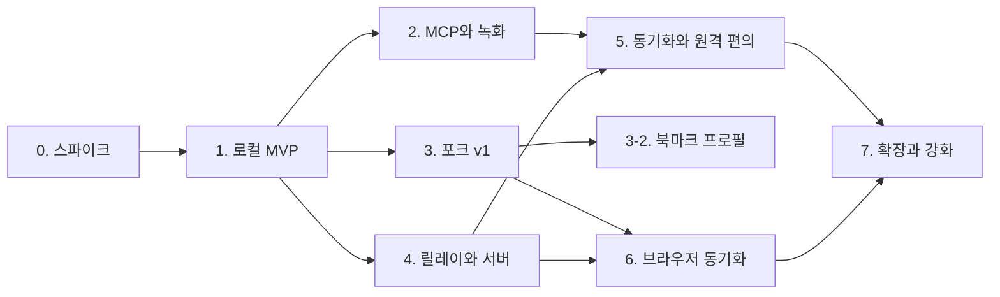

# pegboard-browser 로드맵

- 작성일: 2026-11-10
- 상태: 사용자 승인 (2026-11-10). 0단계 검증 결과에 따라 고친다.
- 포크 시점은 결정됐다(2026-11-10): 로컬 MVP 다음, 3단계.

## 순서를 정한 원칙

1. **가장 큰 위험을 가장 먼저, 가장 싸게 확인한다.** 가려진 탭에서의 자동화, CDP 프록시와 agent-browser의 궁합이 틀리면 설계가 바뀐다. 포크를 만들기 전에 순정 Chromium으로 확인할 수 있다.
2. **코어를 포크와 독립적으로 만든다.** 세션, 프록시, 녹화, CLI, MCP는 모두 브라우저 밖 프로세스에 있다. 순정 Chromium과 작은 확장 프로그램으로 먼저 동작시키고, 포크는 그 확장 프로그램을 내장 브리지로 바꾸는 일로 좁힌다.
3. **단계마다 실제로 쓸 수 있는 것이 나온다.**

Chromium 포크가 3단계에 오는 것은 포크를 미루려는 것이 아니라, 포크가 해야 할 일을 1~2단계에서 확정한 뒤 착수하기 위해서다. 사용자가 이 순서를 승인했다.

## 한눈에 보기

| 단계 | 이름 | 끝나면 동작하는 것 |
|---|---|---|
| 0 | 검증 스파이크 | 제품 없음. 미확인 가정 13개의 답 |
| 1 | 로컬 MVP | 순정 Chromium에서 세션 생성, 탭그룹 격리, CLI로 제어, 동작 로그 |
| 2 | MCP와 녹화 | 2a: MCP 서버와 세션 정책(완료). 2b: 화면 녹화와 재생 |
| 3 | Chromium 포크 v1 | 설치 가능한 Pegboard 브라우저 (macOS), 자동 업데이트 |
| 3-2 | 북마크 프로필 | 북마크바 왼쪽 선택기로 북마크 묶음 전환 |
| 4 | 릴레이와 호스팅 서버 | 원격 머신의 브라우저에 세션을 만들고 제어 |
| 5 | 설정 동기화와 원격 편의 | Pegboard 설정 동기화, 원격 녹화 열람, 원격 화면 보기 |
| 6 | 브라우저 동기화 | 북마크, 방문 기록, 탭, 확장 프로그램, 환경설정이 기기 사이에 동기화 |
| 7 | 확장과 강화 | 추가 OS, 터널 종단 간 암호화, 팀 권한 |

---

## 0단계. 검증 스파이크

**완료 (2026-11-10)**: 가정 13개 모두 판정했다. 맞다 7, 조건부 5, 목록 작성 1, 틀리다 0. 1단계 착수 조건(A1, A2, A5, A11)을 충족한다. 설계 변경 9건을 architecture.md에 반영했다. 미실시 항목(화면 잠금, 설정 누출 등)은 1단계 할 일로 넘겼다. 결과는 [spike-findings.md](./spike-findings.md).

**목적**: [architecture.md 12절](./architecture.md#12-미확인-가정-모음)의 가정 A1~A13에 답한다(A14, A15는 3단계 전 조사에서). 버릴 코드다.

**할 일**

| 스파이크 | 확인할 가정 | 방법 |
|---|---|---|
| S1. 가려진 탭 | A1 | 순정 Chromium을 띄워 놓고, 다른 탭을 보는 상태에서 뒤쪽 탭에 agent-browser로 스냅샷, 클릭, 스크린샷, 화면 캡처를 실행한다. 창을 최소화한 상태, 다른 앱에 가려진 상태도 본다. 화면이 잠긴 상태도 본다(원격 데스크톱에서 흔하다). 관련 명령줄 플래그의 효과를 잰다 |
| S2. 프록시 | A2, A3, A8, A9 | 타깃 하나만 통과시키는 최소 CDP 프록시를 만들고 agent-browser를 `--cdp`로 붙여 주요 명령을 돌린다. agent-browser가 쓰는 CDP 메서드 목록을 뽑는다 |
| S3. 탭그룹 | A4, A5, A7 | 최신 CDP 프로토콜 정의에서 탭그룹을 찾는다. 확장 프로그램으로 탭그룹을 만들고 타깃 ID와 대응시킨다. 별도 브라우저 컨텍스트의 탭이 어디에 열리는지 본다 |
| S5. 프로필 격리 | A11, A12, A13 | 프로필 두 개를 띄운 브라우저에 CDP로 붙어, 타깃마다 프로필을 구분할 수 있는지와 특정 프로필에 창과 탭을 만들 수 있는지 본다. 프로필 사이에 새는 항목(설정, 권한, 확장 프로그램)을 목록으로 만든다. 확장 프로그램 판 브리지가 에이전트 프로필에만 설치되는지도 본다. 열려 있는 프로필을 복사해 새 프로필로 띄우고 로그인이 유지되는지, 브라우저를 끄지 않고 프로필을 만들고 지울 수 있는지 본다 |
| S4. 빌드 | A6, A10 | Chromium을 한 번 빌드해 시간과 디스크를 잰다. 브랜딩 패치 하나를 적용해 본다. 파이프 CDP 코드를 읽고 A6의 패치 크기를 가늠한다 |

**끝나는 조건**
- 가정 13개 각각에 "맞다 / 틀리다 / 조건부"와 근거가 적혀 있다.
- A1이나 A2가 틀렸다면 architecture.md를 고치고 다시 승인을 받는다.
- S4의 실측치로 3단계의 장비와 비용 계획을 쓸 수 있다.

**동작하는 것**: 없음.

---

## 1단계. 로컬 MVP (포크 없음)

**완료 (2026-11-13)**: 구현과 자동 시험은 끝났고 수동 확인 9개(M1~M7, M8, M8b)를 수행했다(데스크톱을 조작하는 에이전트가 수행, 결과는 [phase1-manual-checks.md](./phase1-manual-checks.md)). 8개는 기대대로였다. M5(다운로드 경로)에서 에이전트가 받은 파일이 macOS 사용자의 `~/Downloads`에 생기는 것을 발견했고, 에이전트 프로필의 다운로드를 막아 고쳤다(자동 시험 `agent_download_writes_no_file` 외 3개). 그 밖에 남은 것: M2는 전체 화면 Space로만 확인했다(창 모드로 두 번째 일반 데스크탑에 둔 경우는 하지 않았다). M8b의 타이핑은 사람이 아니라 합성 키 입력이었다.

**목적**: 핵심 고리 하나를 끝까지 잇는다. 에이전트가 세션을 만들고, 탭그룹 안에서만 작업하고, 그 기록이 남는다.

**구성**: 순정 Chromium(또는 Chrome for Testing) + 탭그룹용 작은 확장 프로그램 + `pegboard` 바이너리 + 동봉한 agent-browser. 이 단계에서는 `pegboardd`가 브라우저를 띄우는 부모가 된다.

**할 일**
1. 작업공간과 프로토콜 타입 크레이트. 코어 API 메시지 정의. 공개 저장소 준비: MIT `LICENSE`, 동봉하는 agent-browser의 라이선스와 고지 파일.
2. `pegboardd`: 브라우저 실행과 CDP 연결, 세션 저장소, 유닉스 소켓 API. 1~2단계에서는 파이프 대신 루프백 디버깅 포트를 쓴다(0단계에서 검증한 구성). 프록시의 브라우저 쪽 연결을 갈아 끼울 수 있게 만들어 3단계에서 파이프로 바꾼다.
3. 에이전트 프로필: 기본 프로필 생성, 전용 창 열기, 사람 프로필과의 구분. `profile list|create|open|delete`와 `session create --profile` (빈 프로필만).
4. 세션별 CDP 프록시: 프로필 경계 판정, 타깃 필터링, 메서드 허용목록(0단계의 23종에서 시작). `Target.createTarget`을 가로채 브리지로 탭을 만들고 프로필을 검증한다. 프로필을 지정하지 않는 브라우저 수준 메서드는 거부한다. 탭마다 포커스 에뮬레이션을 건 CDP 세션을 유지한다.
5. 브리지(확장 프로그램 판): 탭그룹 생성, 에이전트 프로필에 탭 만들기. **첫 작업으로 서비스 워커 수명을 검증한다.** 확장이 `pegboardd`와 연결을 유지해 45초 뒤에도 호출되는지 본다. 확장은 에이전트 프로필의 탭만 다룬다.
6. CLI: `browser start|stop|status`, `session create|list|info|close`, 동작 명령 통과와 전역 플래그 거부.
7. agent-browser 동봉: 버전·체크섬 고정, 전용 소켓 디렉터리, 세션별 실행.
8. 동작 로그(`actions.jsonl`)와 비밀번호 입력 가림.
9. 격리 시험: 세션에서 다른 세션의 탭과 사람 프로필의 탭에 접근을 시도하는 시험 묶음. 이후 모든 단계에서 유지한다. 반드시 넣을 경우: 사람 창이 마지막으로 활성인 상태에서 탭을 만들어도 에이전트 프로필에 생긴다, 컨텍스트 없는 쿠키 조회가 거부된다.
10. 세션 수명 처리: 세션을 붙인 직후 `stream disable`, 종료 때 `pegboardd`가 탭을 닫는다. 정책 판정은 `pegboardd`가 한다(2단계에서 확장).
11. 0단계에서 못 한 확인: 화면 잠금과 다른 데스크톱 공간에서의 동작, 브라우저 설정과 다운로드 경로의 프로필 간 누출.

**동작하는 것** (각 줄 끝: 자동 시험 / 수동 확인 대기)
- `pegboard session create --name "조사"`를 실행하면 에이전트 프로필의 창에 "조사" 탭그룹이 생긴다. → 자동 시험: `create_opens_group_in_agent_window`, `two_sessions_with_the_same_name_get_separate_groups`(e2e_session), `full_flow`(e2e_cli). 화면 잠금, 다른 공간, 절전 중의 동작은 수동 확인 M1~M3에서 기대대로였다(2026-11-13).
- `pegboard --session s_x open ...`, `snapshot -i`, `click @e1`, `fill @e2 ...`가 그 탭그룹 안에서 동작한다. → 자동 시험: `drives_the_session_tab`(e2e_runner), `full_flow`. 가려진 탭에서의 속도는 `hidden_session_tab_click_is_fast`, `session_tab_stays_responsive_when_hidden`.
- 세션 두 개를 동시에 돌려도 서로의 탭이 보이지 않는다. 사람 프로필의 탭과 로그인 상태는 에이전트에게 닿지 않는다. → 자동 시험: 격리 시험 묶음 e2e_isolation의 `agent_cannot_list_or_switch_to_human_tabs`, `agent_cannot_read_human_cookies_or_storage`, `new_tabs_always_open_in_the_agent_profile`, `sessions_in_one_profile_share_cookies_but_not_tabs`, `agent_cannot_reach_other_sessions_tabs_by_id`, `session_cannot_use_another_sessions_handle`, `escape_flags_and_commands_are_refused`, `agent_actions_do_not_change_the_humans_active_tab`(브라우저 안의 활성 탭과 `hasFocus`만 증명, OS 포커스는 M8b), `stream_port_is_closed_for_every_session`, e2e_isolated_world의 `universal_access_isolated_world_cannot_escape`, e2e_proxy의 `browser_level_cookie_read_is_refused_and_page_level_is_scoped`와 `created_tab_lands_in_agent_profile_even_when_human_window_is_active`("사람 창이 마지막 활성" 전제는 Chrome을 다시 실행해 새 사람 창을 여는 방식으로 만들고 컨텍스트 없는 `createTarget`으로 확인한다. 사람의 실제 클릭은 M8), `tab_created_in_another_context_is_refused`(프록시가 다른 프로필에 생긴 탭을 거부함). 사람이 탭그룹 사이로 탭을 끄는 경우(M6), 에이전트 창 닫기(M7), 사람 창 클릭 뒤의 `tab new`(M8), 에이전트 동작 중 맨 앞 앱(M8b)은 수동 확인에서 기대대로였다(2026-11-13).
- 세션에서 한 동작이 `actions.jsonl`에 남고 `pegboard recording show`로 읽을 수 있다. → 자동 시험: `every_command_is_logged_with_url_and_outcome`, `password_text_never_reaches_the_log`와 가림 시험들(e2e_actionlog), `full_flow`.
- `pegboard profile create work`로 프로필을 만들고 `session create --profile work`로 그 프로필의 창에서 세션을 연다. 기본 프로필과 로그인 상태가 섞이지 않는다. → 자동 시험: `named_profile_is_isolated_from_default`(e2e_session), `sessions_in_different_profiles_share_nothing`(e2e_isolation). 설정은 수동 확인 M4에서 새지 않았다(2026-11-13). 다운로드 경로는 M5에서 기대와 달랐다: 받은 파일이 사람이 쓰는 `~/Downloads`에 생긴다.
- macOS에서만.

**아직 안 되는 것**: MCP, 화면 녹화, 정책, 사람이 평소 쓰는 브라우저로서의 사용(순정 Chromium이라), 원격.

**이 단계의 한계**: 루프백 디버깅 포트가 열려 있어, 같은 사용자로 도는 로컬 프로세스는 브라우저 전체에 붙을 수 있다. 격리가 막는 것은 제공된 도구를 통해 조종당한 에이전트다. 이 단계의 브라우저에는 실제 계정을 넣지 않는다.

**실행 계획**: [plans/2026-11-11-phase1-local-mvp.md](./plans/2026-11-11-phase1-local-mvp.md)

---

## 2단계. MCP와 녹화

**목적**: 에이전트가 실제로 붙어 쓸 수 있는 인터페이스와, 작업을 되돌아볼 수 있는 기록을 갖춘다.

2단계는 커서 둘로 나눴다(사용자 결정, 2026-11-13): **2a**는 MCP와 세션 정책, **2b**는 화면 녹화와 재생. 프로필 복사(아래 10번)는 로그인 정보를 복제하는 일이라 따로 설계하기로 하고 2b 뒤로 미뤘다.

**할 일** (괄호는 맡은 단계)
1. `pegboard mcp`: Pegboard 고유 도구와 브라우저 동작 도구. 도구 묶음 선택. (2a. 동작 도구는 agent-browser의 것을 중계하지 않고 허용 명령 문법에서 생성한다: architecture.md 7절)
2. CLI와 MCP 동등성 시험: 같은 코어 API를 거치는지, 결과가 같은지. (2a)
3. 화면 녹화: 탭별 화면 캡처, 변화 프레임 저장, 색인. (2b)
4. 탐색 기록, 사람 개입 감지. (2b)
5. 재생 화면: 동작 목록과 화면의 시간축 연결. `recording open`, `recording export`. (2b)
6. 보존 정책과 자동 삭제. 도메인 단위 화면 기록 끄기. (2b)
7. 정책: 동작 분류별 허용·거부, 도메인 허용목록(프록시 구현). (2a. 확인 요청과 실시간 승인은 하지 않았다: 아래 "2a가 남긴 것")
8. 페이지 출력 경계 표식을 기본으로 켠다. (2a)
9. 선택 기록: 네트워크 메타데이터, 콘솔. (2b)
10. 프로필 복사: `profile create --from`, `session create --temp-profile [--from]`, 임시 프로필 자동 삭제와 비정상 종료 뒤 정리. (2b 뒤)

### 2a. MCP와 세션 정책

**자동 시험 완료 (2026-11-14)**. 설계는 [plans/2026-11-13-phase2a-mcp-and-policy-design.md](./plans/2026-11-13-phase2a-mcp-and-policy-design.md), 실행 계획은 [plans/2026-11-13-phase2a-mcp-and-policy.md](./plans/2026-11-13-phase2a-mcp-and-policy.md). 손으로 하는 확인 N1~N4([phase2a-manual-checks.md](./phase2a-manual-checks.md))는 아직 하지 않았다.

**동작하는 것** (각 줄 끝: 자동 시험)
- MCP 클라이언트 설정에 `pegboard mcp`를 넣으면 셸 없는 에이전트가 세션을 만들고 브라우저를 조종하고 자기 세션의 기록을 읽는다. 서버가 끝나면 자기가 만든 세션을 닫는다. → e2e_mcp의 `mcp_starts_the_daemon_and_creates_a_session`, `sessions_are_closed_when_stdin_closes`, `sessions_are_closed_on_sigterm`, `sessions_are_closed_on_sigint_and_sighup`, `a_client_that_stops_reading_still_ends_on_sigterm`, `stdin_end_during_a_running_call_ends_the_server`, `requests_written_before_stdin_closes_are_all_answered` 외.
- MCP 명령은 CLI와 같은 길(`daemon::run_command`)을 가고 같은 입력이 거부된다. → e2e_mcp의 `cli_and_mcp_run_the_same_command_the_same_way`, `the_same_inputs_are_rejected_by_both`, `the_session_policy_applies_to_mcp_actions`, `secrets_typed_over_mcp_are_redacted_like_the_cli`, `page_text_carries_boundary_markers`, `screenshot_returns_an_image`, `downloads_are_told_in_mcp_results`.
- 세션마다 정책이 붙고 에이전트는 넓히지 못한다(`state`, `upload`, `clipboard`는 기본 거부). → pegboard-cli e2e_policy의 `state_commands_need_allow_state`, `deny_eval_blocks_eval_and_wait_fn`, `second_session_cannot_widen_a_pinned_profile`, `upload_needs_allow_and_a_directory`, `upload_cannot_reach_outside_the_directory` 외. e2e_mcp의 `server_policy_is_attached_to_every_session`, `adopted_session_keeps_its_own_wider_policy`.
- 주소 규칙: 자기 포트는 늘 닫히고, 사설망은 열어야 열리고, 허용목록을 걸면 그 밖으로 나가지 못한다. → pegboard-cli e2e_policy의 `own_ports_are_never_reachable`, `private_network_is_closed_unless_allowed`, `public_name_resolving_to_a_private_address_is_blocked`, `redirect_to_private_address_is_blocked`, `allow_domain_closes_everything_else_including_localhost`, `pages_from_a_public_address_get_the_csp`, `workers_follow_the_rules_task_2_established` 외. pegboard-core e2e_policy의 `agent_cannot_turn_the_guard_off`, `the_human_profile_is_untouched`, `commands_are_refused_while_the_guard_is_down`, `created_tabs_wait_for_the_guard` 외.
- 다운로드는 시작한 탭의 세션 파일 디렉터리로만 가고 한도를 넘거나 세션을 알 수 없으면 지워진다. → pegboard-cli e2e_policy의 `download_lands_in_the_session_files_dir_only`, `deny_download_writes_no_file_anywhere`, `oversized_download_is_dropped_and_reported`, pegboard-core e2e_policy의 `a_running_download_over_the_limit_is_cancelled`, `download_policy_is_reapplied_after_its_connection_drops` 외, e2e_isolation의 `agent_download_writes_no_file`, `unattributed_download_is_deleted`.
- 클립보드는 허용하지 않은 세션에서 읽기도 쓰기도 막힌다. → pegboard-core e2e_clipboard의 `agent_cannot_write_the_clipboard_by_default`, `agent_cannot_read_the_clipboard_by_default`, `allow_clipboard_opens_it`, `new_tabs_popups_and_frames_are_covered`, `agent_scripts_cannot_run_before_the_shield`, `document_open_and_write_do_not_remove_the_shield` 외.
- 쉬는 세션(마지막 명령 뒤 1시간)은 닫힌다. → e2e_cli의 `idle_session_is_closed_after_the_expiry`.
- 격리 시험 묶음의 MCP 판: MCP 도구만 가진 에이전트가 사람 프로필, 다른 서버나 사람의 세션, 세션 밖의 브라우저, 더 넓은 정책, 토큰에 닿지 못한다. 시험마다 새 브라우저를 띄우며 이후 모든 단계에서 유지한다. → e2e_mcp_isolation의 `mcp_agent_cannot_list_or_switch_to_human_tabs`, `mcp_agent_cannot_read_human_cookies_or_storage`, `mcp_new_tabs_open_in_the_agent_profile_with_the_human_window_last_active`, `mcp_agent_cannot_reach_another_servers_session`, `mcp_agent_cannot_widen_its_policy`, `mcp_results_and_errors_never_carry_tokens_or_ports`, `mcp_agent_cannot_reach_pegboards_own_ports_or_the_private_network`, `mcp_agent_cannot_write_the_clipboard`, `mcp_download_lands_only_in_the_session_dir`, `killed_mcp_server_leaves_sessions_that_expire`, `mcp_upload_cannot_read_outside_its_upload_dir`, `mcp_page_content_markers_wrap_page_text_and_a_page_cannot_end_the_block`, `mcp_clipboard_denied_session_can_still_run_vitals`, `mcp_server_cannot_drive_a_cli_session_it_did_not_adopt`, `mcp_operator_mode_cannot_drive_other_sessions`.
- 시험 브라우저: 격리 시험 묶음 말고는 시험 파일 하나가 브라우저 하나를 같이 쓴다(전체 실행의 브라우저 실행이 107번에서 37번으로 줄었다. 2a 작업 1).

**2a가 남긴 것**
- 확인 요청과 실시간 승인: 2a는 "사람이 세션을 만들 때 열지 않은 것은 거부"다(사용자 결정 D5). 브라우저 승인 창은 3단계(포크)의 일이다.
- `network route`(에이전트의 요청 가로채기): 데몬의 요청 가드와 함께 쓸 규칙을 설계해야 한다.
- 브라우저 수준 자동 연결을 넘기지 않고 프록시가 흉내 내는 방식(1단계에서 넘어온 것).
- 데몬이 띄우는 자식 프로세스(agent-browser, Chrome)에 열린 파일 기술자가 새지 않게 정리하기(1단계에서 넘어온 것).
- `sandbox`의 `srcdoc` 프레임을 다시 읽게 하는 비용(그 프레임의 상태가 사라지고, 3번을 넘으면 탭을 닫는다).
- 정책을 다시 걸 때 에이전트 프로필의 탭을 활성화해 사람의 키보드 초점을 가져갈 수 있는 것(수동 확인 N3로 잰다).
- 서비스 워커의 주 스크립트 요청이 가로채기에 잡히지 않는 것.
- 정책이 허용한 루프백이나 사설망 주소의 문서가 연 웹소켓이 주소 규칙 밖인 것.
- Chrome이 호스트 이름을 데몬과 다르게 푸는 경우(DNS-over-HTTPS, rebinding)의 사설 주소 접근과 그 부작용.
- 허용목록이 없는 세션에서 공개 사이트의 평문 `ws://`가 막히는 것(CSP로 "사설망만 빼고"를 말할 수 없다).
- 재지 않은 클립보드 경로: 오른쪽 클릭 메뉴, 사람의 직접 입력(수동 확인 N1, N2).
- 탭을 그룹 사이로 끌었을 때 소속: 2a도 "소속은 탭을 따라간다"(사용자 결정 D4)이고, 세션을 닫으면 자기 탭만 닫는다. 그룹을 따라 소속이 바뀌게 할지는 정하지 않았다.
- 토큰 없는 코어 API(`session list`, 기록 조회, `profile delete`, `browser stop`, 운영자용 `session.info_any`/`close_any`)의 권한 모델: 2a는 데몬에 호출자 구분을 넣지 않고 MCP 서버 프로세스가 구분한다.
- 기록 보존 기간(2b).

### 2b. 녹화와 재생

할 일 3, 4, 5, 6, 9. 설계 전이다.

**동작하는 것** (2단계 전체를 마친 뒤)
- MCP 클라이언트 설정에 `pegboard mcp`를 넣으면 에이전트가 세션을 만들고 브라우저를 제어한다. (2a)
- 세션에 도메인 허용목록을 걸면 그 밖의 도메인으로 나가지 못한다. (2a)
- 세션이 끝나면 `pegboard recording open`으로 무슨 일이 있었는지 화면과 함께 볼 수 있다. (2b)
- `session create --temp-profile --from default`로 기본 프로필의 로그인을 가진 채 시작하고, 세션을 닫으면 그 프로필이 사라진다. (2b 뒤)

**아직 안 되는 것**: 설치형 브라우저, 원격, 실시간 승인.

**수동 확인에서 넘어온 것 (2026-11-13)**
- (2a에서 고침) 다운로드 경로(M5): 에이전트가 받은 파일이 `~/Downloads`에 확인 창 없이 저장되던 것. 1단계에서 에이전트 프로필의 다운로드를 막았고, 2a에서 다운로드를 시작한 탭의 세션 파일 디렉터리로 받게 했다(README "세션 정책"). 참고: Chrome은 `browserContextId`를 그 시점에 기본 컨텍스트(마지막으로 활성이던 프로필)인 프로필에서만 찾는다. 정책은 건 연결이 닫히면 사라지고, 한 연결은 컨텍스트 하나의 정책만 쥔다. 그래서 프로필마다 데몬 수명 동안 열려 있는 연결을 따로 둔다.
- (2a에서 고침) `pegboard tab new 'data:...'`이 `about:blank`로 열리던 것. 브리지가 빈 탭을 만든 뒤 CDP로 이동한다(시험 `tab_new_opens_a_data_url`).
- 그룹에 탭이 하나뿐이면 사람이 그 탭을 끌 때 그룹 전체가 움직인다(Chrome의 동작). 그룹을 따라 소속을 바꿀지 정할 때 참고한다.

---

## 3단계. Chromium 포크 v1

**목적**: 사람이 평소에 쓰는 브라우저로 설치할 수 있게 한다. 확장 프로그램으로 우회하던 것을 내장 브리지로 바꾼다.

**착수 전**: 5절의 [미확인] 항목을 다시 조사한다. 다른 포크들의 패치 관리 방식, 릴리스 주기, 서명과 업데이트 방법. 가정 A14(동기화 엔진 재사용)와 A15(웹 스토어 확장, 비밀번호 관리 확장 동작)도 이때 확인한다.

**할 일**
1. 패치 저장소 구조: 버전 고정, `patches/`, `pegboard/`, 적용·빌드 스크립트.
2. 패치: 브랜딩.
3. 패치: 코어 부트스트랩. 브라우저가 `pegboardd`를 띄우고 파이프 CDP를 넘긴다. 1단계의 "데몬이 부모" 구성을 뒤집는다.
4. 패치: `Pegboard` CDP 도메인(탭그룹, 에이전트 프로필 관리). 확장 프로그램 판 브리지를 대체한다.
5. 패치: 에이전트 탭그룹 표시, 확인 창.
6. (삭제) 가려진 탭의 렌더링 유지 패치는 필요 없다. CDP 호출로 해결됐다.
7. 패치: 구글 로그인 UI 정리, 내장 비밀번호 관리자 끄기.
8. 빌드 파이프라인: CI 빌드, 캐시, `pegboard`와 agent-browser 동봉.
9. 서명, 공증, 설치 패키지, 자동 업데이트, `stable`과 `canary` 채널.
10. 리베이스 자동화: 새 Extended Stable 태그와 보안 수정 릴리스 감지, 패치 적용 시도, 빌드와 시험, 결과 보고.
11. 리베이스 예행연습: 다음 주 버전으로 한 번 올려 보고 걸린 시간을 기록한다.
12. 구버전 경고: 보안 수정 반영이 목표 기한을 넘기면 브라우저에 표시.

**동작하는 것**
- macOS에 Pegboard 브라우저를 설치해 기본 브라우저로 쓸 수 있다.
- 비밀번호는 Bitwarden 같은 확장 프로그램으로 관리한다. 브라우저는 비밀번호 저장을 제안하지 않는다.
- 브라우저를 켜면 `pegboardd`가 같이 뜨고, 1~2단계의 CLI와 MCP가 그대로 동작한다.
- 에이전트가 제어하는 탭그룹이 눈에 띄게 표시된다.
- 새 Chromium 버전이 나오면 업데이트가 내려간다.
- TCP 디버깅 포트가 열려 있지 않다.

**아직 안 되는 것**: 원격, 기기 사이 동기화, macOS 외 OS.

---

## 3-2단계. 북마크 프로필

**목적**: 브라우저 프로필 하나 안에서 북마크 묶음을 여러 개 쓰고, 북마크바 왼쪽의 선택기로 바꾼다. 설계는 architecture.md 14절.

**전제**: 3단계(포크, 빌드와 배포 파이프라인)가 끝나 있어야 한다. 4단계와는 독립이라 순서를 바꿀 수 있다. 선택 범위는 브라우저 프로필 전체로 정해졌다. Q12의 나머지(주소창 제안, 화면 이름)는 제안값으로 진행한다.

**할 일**
1. 북마크 프로필 서비스: 전용 상위 폴더, 목록, 현재 선택. 선택은 브라우저 프로필의 설정 값 하나로 저장하고, 바뀌면 그 프로필의 모든 창 북마크바를 갱신한다.
2. 패치: 북마크바가 현재 선택된 폴더를 보여 주게 한다. 북마크바 폴더를 직접 가리키는 곳을 찾아 바꾼다.
3. 선택기 버튼과 메뉴: 전환, 새로 만들기, 이름 바꾸기, 삭제.
4. 별표 버튼과 "북마크바에 추가"의 기본 저장 위치를 현재 선택으로.
5. 시험: 전환, 끌어다 놓기, 넘치는 항목 메뉴, 북마크 관리자에서의 이동, 가져오기와 내보내기.
6. 리베이스 예행연습: 이 패치가 다음 버전에서 충돌하는지 본다.

**동작하는 것**
- 북마크바 왼쪽 끝에서 "업무"를 고르면 북마크바가 업무용 북마크로 바뀐다. 탭과 로그인은 그대로다.
- 기존 북마크는 "기본"에 그대로 있다.
- 6단계가 끝나면 북마크 프로필도 다른 기기로 동기화된다.

**3단계 전에 쓰고 싶다면**: 확장 프로그램으로 임시 구현할 수 있다. 선택기는 북마크바가 아니라 도구 모음 버튼이 된다.

---

## 4단계. 릴레이와 호스팅 서버

**목적**: 원격 머신의 브라우저를 로컬과 같은 명령으로 제어한다.

**할 일**
1. 호스팅 서버 최소판: 계정, 기기 승인 흐름, 토큰, SQLite 저장.
2. 릴레이 등록: 코드 발급과 승인, 키 쌍 생성, OS 키 저장소.
3. 터널: 릴레이 상시 연결, 클라이언트 스트림, 서버의 스트림 중개, 재접속.
4. 릴레이: 브라우저 실행·종료, 코어 API 중계, 로컬 허용목록.
5. `pegboard relay install`: 사용자 단위 상주 서비스 (macOS 먼저).
6. 클라이언트: 터널 전송 계층, `--browser <릴레이>`, 세션과 브라우저 대응 기억.
7. `pegboard browser list`에 릴레이 상태 표시.
8. 서버 컨테이너 이미지와 자체 호스팅 문서.
9. 보조 전송: `--browser ssh://user@host` (서버 없이 쓰는 경로).

**동작하는 것**
- 다른 맥에서 `pegboard relay enroll`과 `install`을 하면 그 머신이 `pegboard browser list`에 나타난다.
- `pegboard session create --browser office-mac`으로 그 머신에 탭그룹이 생기고, 이후 명령은 로컬과 똑같이 쓴다. MCP에서도 같다.
- 원격 머신이 NAT 뒤에 있어도 된다.
- 서버를 직접 띄워 쓸 수 있다.
- 원격 세션의 녹화는 원격 머신에 남는다.

**아직 안 되는 것**: 설정 동기화, 원격 녹화 열람, 화면 없는 서버.

---

## 5단계. 설정 동기화와 원격 편의

**할 일**
1. Pegboard 설정 동기화: 정책, 녹화 설정, 릴레이 별명. "서버 정책은 조이기만 한다" 규칙.
2. 원격 녹화 열람: 터널로 필요할 때 가져오기, 별도 권한.
3. 원격 화면 실시간 보기: 화면 프레임 스트림. 필요하면 직접 연결 추가.
4. 원격에서 온 확인 요청을 로컬에서 승인.
5. 릴레이 관리 화면(웹): 상태, 폐기, 접근 권한.

**동작하는 것**
- 한 머신에서 바꾼 정책이 다른 머신에 적용된다.
- 원격 세션의 녹화를 로컬에서 재생한다.
- 원격 브라우저에서 에이전트가 하는 일을 실시간으로 본다.

---

## 6단계. 브라우저 동기화

**목적**: 사람의 프로필을 크롬처럼 기기 사이에 동기화한다. 비밀번호는 대상이 아니다.

**전제**: 3단계(포크)와 4단계(호스팅 서버, 계정)가 끝나 있어야 한다. 3단계 전 조사에서 가정 A14가 확인되어 있어야 한다.

**할 일**
1. 조사: Chromium 동기화 클라이언트의 구조, 구글 계정 의존 지점, 다른 포크의 자체 동기화 서버 구현과 그 라이선스.
2. 호스팅 서버에 Chromium 동기화 프로토콜 구현 (또는 공개된 구현을 가져와 통합).
3. 패치: 동기화 서버 주소 교체, 구글 계정 로그인을 Pegboard 계정으로 교체.
4. 패치: 동기화 암호화를 기본으로 켜고 암호 설정 절차를 첫 실행에 넣는다.
5. 동기화 대상에서 비밀번호, 패스키, 결제 수단을 뺀다.
6. 에이전트 프로필이 동기화 대상에서 빠지는지 확인하는 시험.
7. 서버 저장량과 백업 계획. 자체 호스팅 문서 갱신.
8. Chromium 버전을 올릴 때 동기화 프로토콜 호환을 확인하는 시험을 리베이스 자동화에 넣는다.

**동작하는 것**
- 두 번째 맥에 Pegboard를 설치하고 로그인하면 북마크, 방문 기록, 열린 탭, 확장 프로그램, 환경설정이 따라온다.
- 비밀번호 관리 확장도 함께 설치되고, 비밀번호 자체는 그 확장의 서비스가 동기화한다.
- 서버는 동기화 자료의 내용을 볼 수 없다.
- 에이전트 프로필의 내용은 어느 기기로도 올라가지 않는다.

**이 단계가 큰 이유**: 포크 다음으로 큰 일이고 업스트림 변화에 민감하다. 4단계까지의 원격 제어 기능과 독립이므로, 원격 제어가 안정된 뒤에 시작한다.

---

## 7단계. 확장과 강화

순서는 수요에 따라 정한다.

- Linux, Windows 빌드와 서명, 릴레이 서비스 설치.
- 화면 없는 서버에서의 원격 실행.
- 터널 종단 간 암호화.
- 팀: 조직, 역할, 릴레이 접근 권한.
- 프록시에서 부족했던 격리를 Chromium 내부로 옮기기.

---

## 일정 없는 후보: 모델 연동

architecture.md 13절의 보조 계층. 구상 단계이고 사용 사례가 정해지지 않아 단계 번호를 주지 않았다. 전부 `pegboardd` 안의 일이라 포크와 무관하고, 2단계가 끝나면 언제든 시작할 수 있다.

시작한다면 이 순서로 한다.
1. 측정부터: 실제 작업 몇 개를 기존 경로로 돌려 왕복 횟수, 시간, 토큰을 잰다. 느린 곳이 어디인지 확인한다.
2. 0층: 묶음 실행과 저장된 흐름을 CLI와 MCP에서 쓰기 쉽게 다듬는다. 모델이 필요 없다.
3. 모델 연결: `model add|list|test`, OpenAI 호환 한 종류, 키는 OS 키 저장소.
4. `recording explain`: 가장 위험이 낮고 녹화 용도(디버깅)와 맞는 첫 기능.
5. `act`와 `extract`: 결정 모델과 작은 언어 모델. 1의 작업으로 다시 재서 비교한다.

5에서 나아진 것이 없으면 거기서 멈춘다.

---

## 단계 사이의 의존

2, 3, 4단계는 1단계만 끝나면 서로 독립이다. 포크를 로컬 MVP 다음에 하기로 했으므로 번호 순서대로 간다. 원격이 더 급해지면 4단계를 3단계 앞에 둘 수 있다. 다만 릴레이가 설치형 브라우저를 띄우려면 3단계의 결과물이 필요하므로, 4단계를 먼저 하면 원격 머신에서도 순정 Chromium을 쓰게 된다.

## 일정에 대해

단계별 기간은 여전히 적지 않았다. 0단계에서 얻은 것은 다음 실측뿐이고, 이것만으로 단계 기간을 쓰면 추측이다.

- 0단계 전체: 하루 안에 끝났다(스크립트 작성과 실행 약 2시간, 그 뒤 Chromium 소스 준비와 빌드 대기 약 3시간 반).
- Chromium: 빈 상태에서 실행 가능한 브라우저까지 약 3시간 20분, 증분 빌드 89초, 디스크 61GB.

기간은 1단계 계획을 세울 때 작업 단위로 추정한다.

## 혼자 개발한다는 전제에서

- 2, 3, 4단계는 서로 독립이지만 동시에 하지 않는다. 번호 순서대로 하나씩 끝낸다.
- 3단계에서 리베이스 자동화를 미루지 않는다. 포크가 생긴 날부터 유지 비용이 시작된다.
- 3단계가 끝난 뒤로는 약 8주마다 리베이스와 보안 수정 반영에 시간이 들어간다. 이후 단계의 속도는 그만큼 느려진다.
- 6단계(브라우저 동기화)는 가장 무겁고 업스트림 변화에 민감하다. 착수 전에 그때까지의 리베이스 소요 시간을 보고 다시 판단한다. 범위를 북마크와 환경설정부터로 줄이는 것도 선택지다.
- 각 단계의 "동작하는 것"이 본인이 실제로 쓰는 상태가 되어야 다음 단계로 간다.
